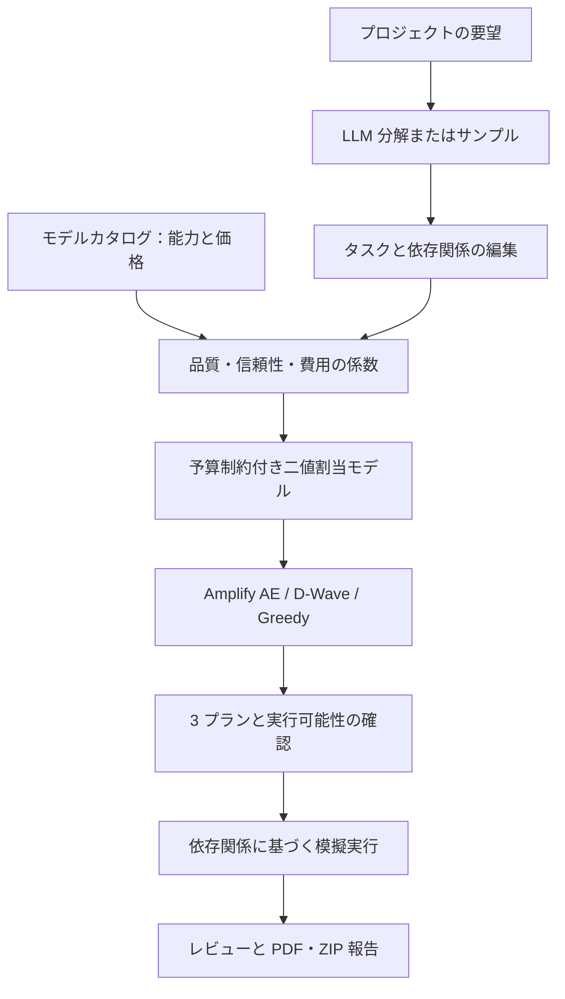

# Quantum Computing for Token Optimization


[English](README.md) · [日本語](README.ja.md) · [简体中文](README.zh-CN.md)

本アプリは、**高度量子人材育成プログラム「TAQUMI」**における受講者の開発作品です。TAQUMI は、**NEDO（国立研究開発法人新エネルギー・産業技術総合開発機構）の「ポスト5G情報通信システム基盤強化研究開発事業」**の一環として、**株式会社Quanmaticと早稲田大学**が共同で企画・運営する、量子計算技術からアプリケーション実装までを学ぶ実践型プログラムです。[プログラム公式サイト](https://taqumi.quanmatic.com/) · [運営者による発表](https://quanmatic.com/news/taqumi-human-resource-development-summer-term-2026/)

**AI タスクを計画し、コストと品質を比較して、担当モデルを選ぶ。**

> 現在のアプリ画面は主に日本語です。バッジは技術構成と実装範囲を示し、テスト成功や実測の量子優位性を示すものではありません。

## このアプリでできること

プロジェクトの要望をタスクに分解し、文書・開発・画像生成の各タスクに担当 AI モデルを割り当てる Streamlit プロトタイプです。ローカルのモデルカタログを用い、予算内で推定品質・信頼性・コストのバランスを求めます。

ここでいう「Token Optimization」は、トークン単価などから見積もった**タスク費用に基づくモデル配置の最適化**です。プロンプト圧縮や生成トークン数そのものの最小化は実装していません。

## 構成と処理の流れ



画面は Streamlit、データ処理と最適化は Python / NumPy、数理モデルと外部ソルバ接続は Amplify、PDF 作成は ReportLab で構成しています。Amplify AE は量子インスパイアード、D-Wave 接続は量子アニーリング、Greedy は古典的な貪欲法です。[コード構成](#code-map)と[計算式](#mathematics)も参照してください。

## セットアップ

Python **3.11〜3.13**、uv、Git を用意し、この非公開リポジトリへのアクセス権があるアカウントで取得します。

```bash
git clone https://github.com/Tsubasaas/Quantum-Computing-for-Token-Optimization.git
cd Quantum-Computing-for-Token-Optimization
uv sync
```

必要に応じて `.env.example` を `.env` にコピーします。PowerShell は `Copy-Item .env.example .env`、macOS / Linux は `cp .env.example .env` を使います。

```bash
uv run streamlit run app/app.py
```

表示されたローカル URL（通常 `http://localhost:8501`）を開きます。API キーなしで試す場合はサンプルタスクを使用し、ソルバを **Greedy** に変更してください。初期選択は Amplify AE です。

| 環境変数 | 用途 |
|---|---|
| `GROQ_API_KEY` / `OPENAI_API_KEY` | LLM によるタスク分解。任意 |
| `GROQ_BASE_URL`, `GROQ_MODEL` / `OPENAI_BASE_URL`, `OPENAI_MODEL` | 接続先・モデルの上書き。任意 |
| `FIXSTARS_AMPLIFY_TOKEN` | Amplify AE 利用時に必要 |
| `DWAVE_API_TOKEN` / `DWAVE_SOLVER` | D-Wave の認証／任意のソルバ指定 |

`.env` は Git の管理対象外です。LLM が使えない場合は入力内容の分解ではなく**サンプルタスク**に切り替わることがあります。ソルバの認証失敗時はエラーを表示し、別ソルバへ自動変更しません。

## 使い方と得られる結果

1. **要望**：例として「イベント申込アプリ、API、テスト、利用説明、告知画像を作りたい」と入力し、対象カテゴリを選びます。
2. **タスク**：難易度、重要度、依存関係、画像枚数、候補モデルを確認・調整し、USD の最大予算とソルバを指定します。
3. **プラン**：費用、0〜5 の推定品質、担当モデル、カテゴリ別内訳、実行段階を比較します。
4. **模擬実行**：実行可能な案を選び、進行を確認して各タスクをレビューします。
5. **出力**：全タスクのレビュー完了後、PDF 報告や ZIP をダウンロードします。ZIP には報告書と添付済みファイルが入り、模擬実行が成果物を新規生成することはありません。従来の詳細画面には手法比較と JSON / CSV 出力もあります。

| プラン | 最大予算に対する上限 | α：品質 | β：信頼性 | γ：コスト |
|---|---:|---:|---:|---:|
| コスト重視 | 30% | 1.0 | 0.3 | 3.0 |
| バランス | 60% | 1.0 | 0.4 | 1.0 |
| 精度重視 | 100% | 1.0 | 0.5 | 0.0 |

**誰に何を任せるか、費用はいくらと見積もるか、どの順序で進めるか**を可視化できます。条件によって3案の割当が同一になる場合もあります。品質スコアはベンチマーク由来の能力値と難易度補正から計算した指標で、利用者のタスクに対する実測正答率ではありません。比較用の単一モデル基準は候補の先頭モデルを使い、能力や予算の制約を満たすとは限りません。

## 実装範囲と評価上の注意

最適化は選択したソルバで実際に行いますが、文書・コード・画像の自動生成は未接続です。実行画面はシミュレーションであり、費用削減率・量子高速化・大域最適性を実証するものではありません。LLM 分解や外部求解にはサービス料金が発生する場合があり、表示費用は生成タスクの見積もりです。

締切制約、依存関係に基づくスケジューリング最適化、負荷分散 μ は量子ソルバの目的関数・制約に含まれません。依存関係は画面の実行順序に使い、完了時間の入力は探索時間の設定に転用しています。カタログの価格・能力・利用可能性は保存時点の情報で、信頼性には推定による補完も含まれます。

<a id="mathematics"></a>
## 数理モデル

以下の式は現行実装に対応します。clip は値を [0, 1] に制限し、添字 k の round は小数点以下 k 桁に丸めます。

### 1. 変数

| 記号 | 意味 |
|---|---|
| $i=1,\ldots,N$ | 候補モデル |
| $j=1,\ldots,M$ | タスク |
| $x_{ij}\in\{0,1\}$ | モデル i がタスク j を担当するなら1 |
| $q_{ij},r_{ij}$ | 品質・信頼性 |
| $c_{ij},\hat c_{ij}$ | USD費用・正規化費用 |
| $w_j=p_j/5$ | 重要度（優先度 p は1〜5） |
| $d_j,n_j$ | 難易度（1〜5）・個数 |
| $B$ | USD予算 |
| $\alpha,\beta,\gamma$ | 品質・信頼性・費用の重み |

### 2. 品質と信頼性

タスクの役割を $\rho_j$、能力値を $s_{ik}$、役割別の合成重みを $b_{\rho_j k}$、役割係数を $f_{\rho_j}$ とします。

$$
Q_{i,\rho_j}=\mathrm{clip}_{[0,1]}\left(f_{\rho_j}\sum_k b_{\rho_j k}s_{ik}\right)
$$

$$
q_{ij}=Q_{i,\rho_j}\max\left(0,1-0.12(d_j-1)\right),\qquad w_j=\frac{p_j}{5}
$$

主能力が欠ける組合せは割当不可です。副能力の欠損は0として合成します。信頼性はカタログ内の SWE-rebench Pass@5 を優先し、無ければ $r_{ij}=\mathrm{clip}_{[0,1]}(Q_{i,\rho_j}+0.10)$ を使用します。この補完値は経験則による推定であり、実測確率ではありません。

### 3. 費用の見積もり

ベンチマークのタスク費用 → 画像モデルの画像単価 → トークン単価 → 既定値の0.20米ドル、の順で利用可能な値を選びます。難易度による倍率は次のとおりです。

$$
m_j=1+0.12(d_j-3)
$$

トークン単価を使う場合、$P_i^{\mathrm{in}}$ と $P_i^{\mathrm{out}}$ は入力・出力それぞれ100万トークンあたりの米ドル価格です。タスク1件の推定単価は次式で求めます。

$$
u_{ij}=\mathrm{round}_4\left[\max\left(0.01,m_j\frac{60000P_i^{\mathrm{in}}+8000P_i^{\mathrm{out}}}{10^6}\right)\right]
$$

ベンチマーク費用の単価下限は0.01米ドル、画像単価の下限は0.001米ドル、既定値は $0.20m_j$ 米ドルです。`cost_for` が小数点以下4桁に丸めます。その後、係数生成時に個数を掛け、最終的な下限を0.01米ドルに設定します。

$$
c_{ij}=\max\left(0.01,u_{ij}\max(1,n_j)\right),\qquad
\hat c_{ij}=\mathrm{clip}_{[0,1]}\left(\frac{c_{ij}}{c_{\max}}\right)
$$

$c_{\max}$ は割当可能な組合せの最大費用で、該当する組合せが無ければ1です。入力60,000・出力8,000トークンは見積もり用の固定前提で、実際の使用量ではありません。

### 4. 目的関数と制約

重要度で重み付けした品質・信頼性から正規化費用の罰則を引いた値を最大化します。

$$
F(x)=\sum_{i=1}^{N}\sum_{j=1}^{M}w_j(\alpha q_{ij}+\beta r_{ij})x_{ij}
-\gamma\sum_{i=1}^{N}\sum_{j=1}^{M}\hat c_{ij}x_{ij}
$$

C1：各タスクにちょうど1つのモデルを割り当てます。

$$
\mathrm{C1}:\quad\sum_{i=1}^{N}x_{ij}=1\quad\forall j
$$

C2：禁止集合 $\mathcal F$ に含まれる組合せを除外します。対象は能力不足、または機密タスクと社外扱いのモデルの組合せです。これは割当規則であり、データのマスキングや安全性を保証する境界ではありません。

$$
\mathrm{C2}:\quad x_{ij}=0\quad\forall(i,j)\in\mathcal F
$$

C3：予算が指定されている場合、その上限を課します。

$$
\mathrm{C3}:\quad\sum_{i=1}^{N}\sum_{j=1}^{M}c_{ij}x_{ij}\le B
$$

### 5. QUBO への変換

ソルバは $E_{\mathrm{obj}}=-F$ を最小化します。各タスクに1モデルだけを選ぶ制約は、次の二次罰則で表せます。

$$
P_{\mathrm{one\text{-}hot}}(x)=\sum_{j=1}^{M}\left(\sum_{i=1}^{N}x_{ij}-1\right)^2
$$

制約なしのエネルギーを概念的に表すと、次式になります。

$$
E(x,z)=-F(x)+\lambda_1P_{\mathrm{one\text{-}hot}}(x)+P_{\mathrm{budget}}(x,z)
$$

$z$ は補助変数、$P_{\mathrm{budget}}$ は予算に関する罰則です。**アプリ側でこの展開や λ の値を手動指定しているわけではありません。** 禁止変数を0に固定し、`Model(objective, constraints)`、`one_hot`、`less_equal` を Amplify に渡して、接続先に応じた変換を任せます。上式は仕組みの説明であり、別途実装された固定の罰則行列ではありません。

### 6. 画面に表示する指標

タスク j の担当モデルを $a(j)$、割当済みタスクの集合を $J_a$ とします。総費用、タスク別の0〜5点の品質、平均品質は次式で求めます。

$$
C_{\mathrm{total}}=\sum_{i,j}c_{ij}x_{ij},\qquad
A_j=\mathrm{round}_2(5q_{a(j),j}),\qquad
\overline A=\mathrm{round}_2\left(\frac{1}{|J_a|}\sum_{j\in J_a}A_j\right)
$$

平均品質は重要度で重み付けせず、割当済みタスクが無ければ0を返します。スコアと併せて `feasible`（実行可能性）、`within_budget`（予算内）、`violations`（違反件数）を確認してください。Greedy は制約を満たさない割当を返す場合があり、結果が存在するだけでは実行可能性を保証しません。

<a id="code-map"></a>
## コード構成

| パス | 役割 |
|---|---|
| [`app/app.py`](app/app.py) | 起動 |
| [`app/app_pages/workspace.py`](app/app_pages/workspace.py) | メイン画面 |
| [`app/delivery.py`](app/delivery.py), [`app/report_pdf.py`](app/report_pdf.py) | 報告出力 |
| [`src/taqumi2026s_teame/llm/`](src/taqumi2026s_teame/llm/) | LLM連携 |
| [`data/__init__.py`](src/taqumi2026s_teame/data/__init__.py) | 品質・費用 |
| [`data/models.json`](src/taqumi2026s_teame/data/models.json) | 保存カタログ |
| [`qubo/coefficients.py`](src/taqumi2026s_teame/qubo/coefficients.py) | 係数行列 |
| [`solvers/`](src/taqumi2026s_teame/solvers/) | 求解 |
| [`plans.py`](src/taqumi2026s_teame/plans.py), [`config.py`](src/taqumi2026s_teame/config.py) | 3案・重み |
| [`evaluation/metrics.py`](src/taqumi2026s_teame/evaluation/metrics.py) | 評価 |
| [`workflow.py`](src/taqumi2026s_teame/workflow.py) | 依存段階 |
| [`tests/`](tests/) | テスト |

## 開発

```bash
uv run pytest
uv run ruff check .
uv run ruff format --check .
uv run mypy src
```

上記は確認用コマンドであり、全項目の成功を示すものではありません。実 API テストには別途認証情報と実行設定が必要です。継承された `qiskit*` と `docplex` は現在の割当処理では使用していません。

## 関連資料と開発記録

- [アプリ詳細](docs/APP_GUIDE.md)
- [データ算出方法](src/taqumi2026s_teame/data/README.md)
- [実装監査](IMPLEMENTATION_AUDIT.md)
- [テストガイド](tests/README.md)

生成 AI（Claude を含む）の開発支援は、各モジュールの記載と監査文書に記録されています。カタログには出典と時点を保存しています。本 README は外部ベンチマークや最新価格の独立検証ではありません。リンク先の詳細資料は現在、主に日本語です。
