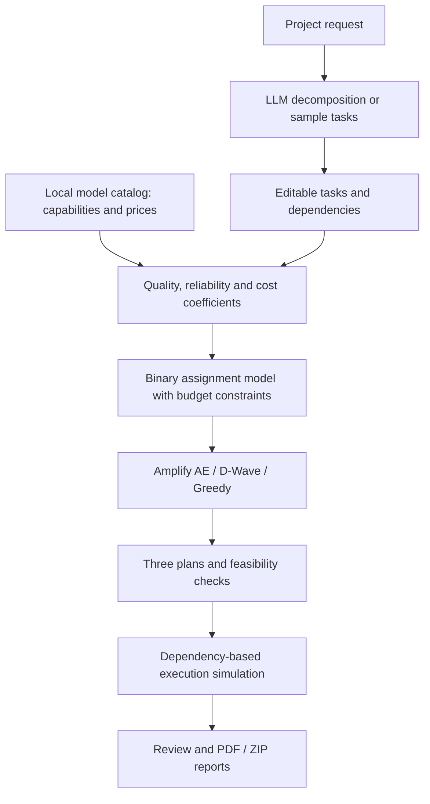

# Quantum Computing for Token Optimization


[English](README.md) · [日本語](README.ja.md) · [简体中文](README.zh-CN.md)

**Plan AI work. Compare cost and quality. Assign the right model to each task.**

> The current app interface is primarily Japanese. Badges describe the technology stack and scope, not verified CI results or measured quantum advantage.

## What the app does

This Streamlit prototype turns a project request into a task-to-model allocation plan. It covers document work, programming, and image generation, combining a local model catalog with a binary optimization model to balance estimated quality, reliability, and cost under a budget.

“Token optimization” here means **optimizing model allocation using estimated task costs**, including token-based price estimates where available. The app does not compress prompts or directly optimize the number of tokens generated.

| Stage | Input / action | Visible result |
|---|---|---|
| 01 Request | Describe a project and select work categories | Tasks from an LLM, or sample tasks when the LLM is unavailable |
| 02 Tasks | Review difficulty, importance, dependencies, quantity, candidates, budget, and solver | An editable task plan and allocation inputs |
| 03 Plans | Solve cost-first, balanced, and quality-first alternatives | Estimated cost, quality score, selected models, category breakdown, and dependency stages |
| 04 Simulation & review | Select an eligible plan, simulate progress, review tasks | Planned deliverables, review records, and downloadable reports |

The workspace supports PDF reports and ZIP delivery packages after simulation and completion of all task reviews. Packages contain reports and any attached files; simulation does not generate code, documents, or images. The legacy detailed pages also provide solver comparisons and JSON/CSV exports.

## How it is built



Python handles data preparation and optimization; Streamlit provides the interface and session state. NumPy supplies coefficient matrices. Amplify expresses the constrained binary model and connects to Amplify AE or D-Wave. ReportLab creates PDF reports. See the [code map](#code-map) for the implementation entry points.

## Install and run

Prerequisites: **Python 3.11–3.13**, **uv**, and Git. Access to this private repository is required to clone it.

```bash
git clone https://github.com/Tsubasaas/Quantum-Computing-for-Token-Optimization.git
cd Quantum-Computing-for-Token-Optimization
uv sync
```

Create the optional configuration file:

```powershell
# Windows PowerShell
Copy-Item .env.example .env
```

```bash
# macOS / Linux
cp .env.example .env
```

```bash
uv run streamlit run app/app.py
```

Open the local URL printed by Streamlit, normally `http://localhost:8501`. For a first run without API credentials, use the sample tasks and select **Greedy** in the solver selector; the initial solver selection is Amplify AE.

| Configuration in `.env` | Purpose |
|---|---|
| `GROQ_API_KEY` | Optional LLM task decomposition |
| `GROQ_BASE_URL`, `GROQ_MODEL` | Optional Groq endpoint/model overrides |
| `OPENAI_API_KEY` | Optional OpenAI-compatible task decomposition |
| `OPENAI_BASE_URL`, `OPENAI_MODEL` | Optional endpoint/model overrides |
| `FIXSTARS_AMPLIFY_TOKEN` | Required when selecting Amplify AE |
| `DWAVE_API_TOKEN` | Required when selecting D-Wave |
| `DWAVE_SOLVER` | Optional D-Wave solver selection |

Keep credentials in `.env`, which is ignored by Git. Missing LLM credentials or decomposition failure can produce **sample tasks**, not a decomposition of your particular request. Missing solver credentials produce a solver error; the application does not silently substitute another solver.

## How to use it and interpret the result

1. Enter a request, for example: “Build an event registration app with a landing page, backend API, tests, documentation, and a promotional image.”
2. Inspect the decomposed tasks and dependencies. Adjust importance, difficulty, image quantity, and model candidates.
3. Set a maximum budget in USD and choose Greedy, Amplify AE, or D-Wave.
4. Compare the three plans below. Check feasibility as well as estimated quality and cost; identical allocations can legitimately appear in multiple plans.
5. Select an eligible plan, run the simulation, complete reviews, and download the report/package.

| Plan | Budget cap relative to your maximum | α quality | β reliability | γ cost |
|---|---:|---:|---:|---:|
| Cost-first | 30% | 1.0 | 0.3 | 3.0 |
| Balanced | 60% | 1.0 | 0.4 | 1.0 |
| Quality-first | 100% | 1.0 | 0.5 | 0.0 |

The practical output is an explainable allocation: **which model handles which task, what it is estimated to cost, and how work is ordered**. The 0–5 quality score is derived from catalog capabilities and difficulty adjustments; it is not a measured success rate on your project. A fixed-model baseline in the optimization result uses the first candidate model and may not satisfy every task's capability or budget constraints.

No measured savings percentage or quantum speedup is claimed. Amplify AE is **quantum-inspired**; the D-Wave path is a **quantum-annealing integration** requiring service access. Greedy is a classical heuristic. Availability of an integration does not establish a successful hardware run or global optimality.

## Current scope

- Implemented: task decomposition, coefficient construction, solver integrations, three-plan comparison, feasibility reporting, simulated execution, reviews, and report packaging.
- Not connected: automatic execution of assigned models to generate the planned artifacts. LLM decomposition and remote optimization can still invoke paid services; the displayed generation-cost estimate is not a complete bill.
- Not enforced by the quantum solver model: task deadlines, dependency scheduling, or load-balancing penalty μ. Dependencies organize the displayed workflow. The completion-time input is repurposed as a solver search-time setting.
- Catalog capabilities, prices, and availability are a repository snapshot. Review their provenance before drawing real-world performance conclusions. Reliability includes a heuristic fallback, as documented in the [formulas](#mathematics).

<a id="mathematics"></a>
## Mathematical model

These equations describe the current implementation. The clip operator limits a value to [0, 1]; round with subscript k rounds to k decimal places.

### 1. Variables

| Symbol | Meaning |
|---|---|
| $i=1,\ldots,N$ | Candidate model |
| $j=1,\ldots,M$ | Task |
| $x_{ij}\in\{0,1\}$ | 1 if model i handles task j |
| $q_{ij},r_{ij}$ | Quality and reliability |
| $c_{ij},\hat c_{ij}$ | USD cost and normalized cost |
| $w_j=p_j/5$ | Importance; priority p is 1–5 |
| $d_j,n_j$ | Difficulty (1–5), quantity |
| $B$ | Budget in USD |
| $\alpha,\beta,\gamma$ | Quality/reliability/cost weights |

### 2. Quality and reliability

For task role $\rho_j$, capability score $s_{ik}$, role blend weight $b_{\rho_j k}$, and role factor $f_{\rho_j}$:

$$
Q_{i,\rho_j}=\operatorname{clip}_{[0,1]}\left(f_{\rho_j}\sum_k b_{\rho_j k}s_{ik}\right)
$$

$$
q_{ij}=Q_{i,\rho_j}\max\left(0,1-0.12(d_j-1)\right),\qquad w_j=\frac{p_j}{5}
$$

A missing primary capability makes an assignment unavailable. Missing secondary capabilities contribute zero. Reliability uses catalog SWE-rebench Pass@5 when present; otherwise $r_{ij}=\operatorname{clip}_{[0,1]}(Q_{i,\rho_j}+0.10)$. This fallback is a heuristic, not a measured probability.

### 3. Cost estimation

Use the first available cost source: benchmark task cost → image price for image models → token pricing → a USD 0.20 fallback. The difficulty multiplier is:

$$
m_j=1+0.12(d_j-3)
$$

For token pricing, $P_i^{\mathrm{in}}$ and $P_i^{\mathrm{out}}$ are input and output prices in USD per million tokens. The estimated unit cost is:

$$
u_{ij}=\operatorname{round}_4\left[\max\left(0.01,m_j\frac{60000P_i^{\mathrm{in}}+8000P_i^{\mathrm{out}}}{10^6}\right)\right]
$$

The benchmark branch has a USD 0.01 unit floor; the image branch has a USD 0.001 unit floor; the fallback uses $0.20m_j$ USD. `cost_for` rounds each to four decimals. The coefficient builder applies quantity and a final USD 0.01 floor:

$$
c_{ij}=\max\left(0.01,u_{ij}\max(1,n_j)\right),\qquad
\hat c_{ij}=\operatorname{clip}_{[0,1]}\left(\frac{c_{ij}}{c_{\max}}\right)
$$

$c_{\max}$ is the maximum cost among allowed assignments, or 1 if none are allowed. The fixed 60,000 input and 8,000 output tokens are estimation assumptions, not measured usage.

### 4. Objective and constraints

Maximize the importance-weighted quality and reliability benefit minus the normalized cost penalty:

$$
F(x)=\sum_{i=1}^{N}\sum_{j=1}^{M}w_j(\alpha q_{ij}+\beta r_{ij})x_{ij}
-\gamma\sum_{i=1}^{N}\sum_{j=1}^{M}\hat c_{ij}x_{ij}
$$

C1 assigns exactly one model to every task:

$$
\mathrm{C1}:\quad\sum_{i=1}^{N}x_{ij}=1\quad\forall j
$$

C2 excludes forbidden pairs in $\mathcal F$: missing capability, or a confidential task paired with a model marked external. This is an allocation rule, not data masking or a security boundary:

$$
\mathrm{C2}:\quad x_{ij}=0\quad\forall(i,j)\in\mathcal F
$$

C3 enforces the budget when one is supplied:

$$
\mathrm{C3}:\quad\sum_{i=1}^{N}\sum_{j=1}^{M}c_{ij}x_{ij}\le B
$$

### 5. QUBO encoding

The solver minimizes $E_{\mathrm{obj}}=-F$. The one-hot constraint has a quadratic penalty form:

$$
P_{\mathrm{one\text{-}hot}}(x)=\sum_{j=1}^{M}\left(\sum_{i=1}^{N}x_{ij}-1\right)^2
$$

The unconstrained energy can be expressed conceptually as:

$$
E(x,z)=-F(x)+\lambda_1P_{\mathrm{one\text{-}hot}}(x)+P_{\mathrm{budget}}(x,z)
$$

$z$ represents auxiliary encoding variables and $P_{\mathrm{budget}}$ the budget penalty. **The application does not manually select this expansion or λ values.** It fixes forbidden variables to zero and passes `Model(objective, constraints)`, `one_hot`, and `less_equal` to Amplify for backend-specific conversion. This expression explains the mechanism, not a separately implemented fixed penalty matrix.

### 6. Displayed metrics

Let $a(j)$ be the assigned model and $J_a$ the set of assigned tasks. Total cost, per-task quality on a 0–5 scale, and average quality are:

$$
C_{\mathrm{total}}=\sum_{i,j}c_{ij}x_{ij},\qquad
A_j=\operatorname{round}_2(5q_{a(j),j}),\qquad
\overline A=\operatorname{round}_2\left(\frac{1}{|J_a|}\sum_{j\in J_a}A_j\right)
$$

The average is unweighted and returns 0 if no task is assigned. Check `feasible`, `within_budget`, and `violations` alongside the score. Greedy may return a constraint-violating assignment; a nonempty result does not prove feasibility.

<a id="code-map"></a>
## Code map

| Path | Responsibility |
|---|---|
| [`app/app.py`](app/app.py) | Streamlit entry and navigation |
| [`app/app_pages/workspace.py`](app/app_pages/workspace.py) | Request → plans → simulation → review |
| [`app/delivery.py`](app/delivery.py), [`app/report_pdf.py`](app/report_pdf.py) | ZIP and PDF delivery |
| [`src/taqumi2026s_teame/llm/`](src/taqumi2026s_teame/llm/) | LLM task decomposition and plan assistance |
| [`data/__init__.py`](src/taqumi2026s_teame/data/__init__.py) | Capability blends and cost estimates |
| [`data/models.json`](src/taqumi2026s_teame/data/models.json) | Versioned catalog |
| [`qubo/coefficients.py`](src/taqumi2026s_teame/qubo/coefficients.py) | Model × task coefficient matrices |
| [`solvers/`](src/taqumi2026s_teame/solvers/) | Amplify AE, D-Wave, Greedy, Random and UI adapter |
| [`plans.py`](src/taqumi2026s_teame/plans.py), [`config.py`](src/taqumi2026s_teame/config.py) | Three plans and weights |
| [`evaluation/metrics.py`](src/taqumi2026s_teame/evaluation/metrics.py) | Objective and feasibility |
| [`workflow.py`](src/taqumi2026s_teame/workflow.py) | Dependency stages |
| [`tests/`](tests/) | Existing tests |

## Development

```bash
uv run pytest
uv run ruff check .
uv run ruff format --check .
uv run mypy src
```

These are verification commands, not a claim that every check passes. Live API tests require separate credentials and opt-in. The inherited `qiskit*` and `docplex` dependencies are unused in the current allocation pipeline.

## Further reading and provenance

- [Application guide](docs/APP_GUIDE.md)
- [Catalog methodology](src/taqumi2026s_teame/data/README.md)
- [Implementation audit](IMPLEMENTATION_AUDIT.md)
- [Test guide](tests/README.md)

The repository records AI-assisted development, including Claude assistance, in module notices and the audit document. Sources and timestamps are stored with the catalog. This README does not independently verify external benchmarks or current prices. The linked detailed documents currently remain primarily Japanese.
