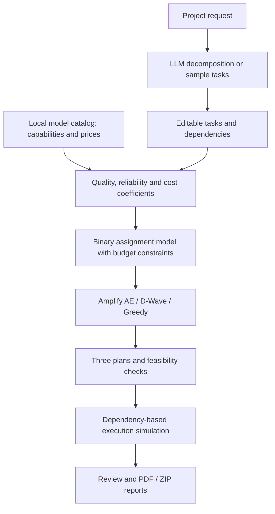

# Quantum Computing for Token Optimization


**Plan AI work. Compare cost and quality. Assign the right model to each task.**
**AI タスクを計画し、コストと品質を比較して、担当モデルを選ぶ。**
**拆解 AI 任务，比较成本与质量，为每个任务分配合适的模型。**

[English](#english) · [日本語](#japanese) · [中文](#chinese) · [Mathematical model / 数理モデル / 数学模型](#mathematics) · [Code map / コード構成 / 代码结构](#code-map)

> This README is trilingual; the current application interface is primarily Japanese. Badges describe the project stack and scope, not verified CI results or measured quantum advantage.
>
> README は3言語対応ですが、現在のアプリ画面は主に日本語です。バッジは技術構成と実装範囲を示します。
>
> README 提供三种语言，当前应用界面主要为日语。徽章表示技术栈与实现范围，不代表测试通过或已验证量子优势。

<a id="english"></a>
## English

### What the app does

This Streamlit prototype turns a project request into a task-to-model allocation plan. It covers document work, programming, and image generation, combining a local model catalog with a binary optimization model to balance estimated quality, reliability, and cost under a budget.

“Token optimization” here means **optimizing model allocation using estimated task costs**, including token-based price estimates where available. The app does not compress prompts or directly optimize the number of tokens generated.

| Stage | Input / action | Visible result |
|---|---|---|
| 01 Request | Describe a project and select work categories | Tasks from an LLM, or sample tasks when the LLM is unavailable |
| 02 Tasks | Review difficulty, importance, dependencies, quantity, candidates, budget, and solver | An editable task plan and allocation inputs |
| 03 Plans | Solve cost-first, balanced, and quality-first alternatives | Estimated cost, quality score, selected models, category breakdown, and dependency stages |
| 04 Simulation & review | Select an eligible plan, simulate progress, review tasks | Planned deliverables, review records, and downloadable reports |

The workspace supports PDF reports and ZIP delivery packages after simulation and completion of all task reviews. Packages contain reports and any attached files; simulation does not generate code, documents, or images. The legacy detailed pages also provide solver comparisons and JSON/CSV exports.

### How it is built



Python handles data preparation and optimization; Streamlit provides the interface and session state. NumPy supplies coefficient matrices. Amplify expresses the constrained binary model and connects to Amplify AE or D-Wave. ReportLab creates PDF reports. See the [code map](#code-map) for the implementation entry points.

### Install and run

Prerequisites: **Python 3.11–3.13**, **uv**, and Git. Access to this private repository is required to clone it.

```bash
git clone https://github.com/Tsubasaas/Quantum-Computing-for-Token-Optimization.git
cd Quantum-Computing-for-Token-Optimization
uv sync
```

Create the optional configuration file:

```powershell
# Windows PowerShell
Copy-Item .env.example .env
```

```bash
# macOS / Linux
cp .env.example .env
```

```bash
uv run streamlit run app/app.py
```

Open the local URL printed by Streamlit, normally `http://localhost:8501`. For a first run without API credentials, use the sample tasks and select **Greedy** in the solver selector; the initial solver selection is Amplify AE.

| Configuration in `.env` | Purpose |
|---|---|
| `GROQ_API_KEY` | Optional LLM task decomposition |
| `GROQ_BASE_URL`, `GROQ_MODEL` | Optional Groq endpoint/model overrides |
| `OPENAI_API_KEY` | Optional OpenAI-compatible task decomposition |
| `OPENAI_BASE_URL`, `OPENAI_MODEL` | Optional endpoint/model overrides |
| `FIXSTARS_AMPLIFY_TOKEN` | Required when selecting Amplify AE |
| `DWAVE_API_TOKEN` | Required when selecting D-Wave |
| `DWAVE_SOLVER` | Optional D-Wave solver selection |

Keep credentials in `.env`, which is ignored by Git. Missing LLM credentials or decomposition failure can produce **sample tasks**, not a decomposition of your particular request. Missing solver credentials produce a solver error; the application does not silently substitute another solver.

### How to use it and interpret the result

1. Enter a request, for example: “Build an event registration app with a landing page, backend API, tests, documentation, and a promotional image.”
2. Inspect the decomposed tasks and dependencies. Adjust importance, difficulty, image quantity, and model candidates.
3. Set a maximum budget in USD and choose Greedy, Amplify AE, or D-Wave.
4. Compare the three plans below. Check feasibility as well as estimated quality and cost; identical allocations can legitimately appear in multiple plans.
5. Select an eligible plan, run the simulation, complete reviews, and download the report/package.

| Plan | Budget cap relative to your maximum | α quality | β reliability | γ cost |
|---|---:|---:|---:|---:|
| Cost-first | 30% | 1.0 | 0.3 | 3.0 |
| Balanced | 60% | 1.0 | 0.4 | 1.0 |
| Quality-first | 100% | 1.0 | 0.5 | 0.0 |

The practical output is an explainable allocation: **which model handles which task, what it is estimated to cost, and how work is ordered**. The 0–5 quality score is derived from catalog capabilities and difficulty adjustments; it is not a measured success rate on your project. A fixed-model baseline in the optimization result uses the first candidate model and may not satisfy every task's capability or budget constraints.

No measured savings percentage or quantum speedup is claimed. Amplify AE is **quantum-inspired**; the D-Wave path is a **quantum-annealing integration** requiring service access. Greedy is a classical heuristic. Availability of an integration does not establish a successful hardware run or global optimality.

### Current scope

- Implemented: task decomposition, coefficient construction, solver integrations, three-plan comparison, feasibility reporting, simulated execution, reviews, and report packaging.
- Not connected: automatic execution of assigned models to generate the planned artifacts. LLM decomposition and remote optimization can still invoke paid services; the displayed generation-cost estimate is not a complete bill.
- Not enforced by the quantum solver model: task deadlines, dependency scheduling, or load-balancing penalty μ. Dependencies organize the displayed workflow. The completion-time input is repurposed as a solver search-time setting.
- Catalog capabilities, prices, and availability are a repository snapshot. Review their provenance before drawing real-world performance conclusions. Reliability includes a heuristic fallback, as documented in the [formulas](#mathematics).

<a id="japanese"></a>
## 日本語

### このアプリでできること

プロジェクトの要望をタスクに分解し、文書・開発・画像生成の各タスクに担当 AI モデルを割り当てる Streamlit プロトタイプです。ローカルのモデルカタログを用い、予算内で推定品質・信頼性・コストのバランスを求めます。

ここでいう「Token Optimization」は、トークン単価などから見積もった**タスク費用に基づくモデル配置の最適化**です。プロンプト圧縮や生成トークン数そのものの最小化は実装していません。

### 構成と処理の流れ

**要望 → LLM 分解／サンプル → タスク編集 → 品質・信頼性・コスト行列 → 制約付き二値最適化 → 3 プラン比較 → 模擬実行 → レビュー・レポート**

画面は Streamlit、データ処理と最適化は Python / NumPy、数理モデルと外部ソルバ接続は Amplify、PDF 作成は ReportLab で構成しています。Amplify AE は量子インスパイアード、D-Wave 接続は量子アニーリング、Greedy は古典的な貪欲法です。[コード構成](#code-map)と[計算式](#mathematics)も参照してください。

### セットアップ

Python **3.11〜3.13**、uv、Git を用意し、この非公開リポジトリへのアクセス権があるアカウントで取得します。

```bash
git clone https://github.com/Tsubasaas/Quantum-Computing-for-Token-Optimization.git
cd Quantum-Computing-for-Token-Optimization
uv sync
```

必要に応じて `.env.example` を `.env` にコピーします。PowerShell は `Copy-Item .env.example .env`、macOS / Linux は `cp .env.example .env` を使います。

```bash
uv run streamlit run app/app.py
```

表示されたローカル URL（通常 `http://localhost:8501`）を開きます。API キーなしで試す場合はサンプルタスクを使用し、ソルバを **Greedy** に変更してください。初期選択は Amplify AE です。

| 環境変数 | 用途 |
|---|---|
| `GROQ_API_KEY` / `OPENAI_API_KEY` | LLM によるタスク分解。任意 |
| `GROQ_BASE_URL`, `GROQ_MODEL` / `OPENAI_BASE_URL`, `OPENAI_MODEL` | 接続先・モデルの上書き。任意 |
| `FIXSTARS_AMPLIFY_TOKEN` | Amplify AE 利用時に必要 |
| `DWAVE_API_TOKEN` / `DWAVE_SOLVER` | D-Wave の認証／任意のソルバ指定 |

`.env` は Git の管理対象外です。LLM が使えない場合は入力内容の分解ではなく**サンプルタスク**に切り替わることがあります。ソルバの認証失敗時はエラーを表示し、別ソルバへ自動変更しません。

### 使い方と得られる結果

1. **要望**：例として「イベント申込アプリ、API、テスト、利用説明、告知画像を作りたい」と入力し、対象カテゴリを選びます。
2. **タスク**：難易度、重要度、依存関係、画像枚数、候補モデルを確認・調整し、USD の最大予算とソルバを指定します。
3. **プラン**：費用、0〜5 の推定品質、担当モデル、カテゴリ別内訳、実行段階を比較します。
4. **模擬実行**：実行可能な案を選び、進行を確認して各タスクをレビューします。
5. **出力**：全タスクのレビュー完了後、PDF 報告や ZIP をダウンロードします。ZIP には報告書と添付済みファイルが入り、模擬実行が成果物を新規生成することはありません。従来の詳細画面には手法比較と JSON / CSV 出力もあります。

| プラン | 最大予算に対する上限 | α：品質 | β：信頼性 | γ：コスト |
|---|---:|---:|---:|---:|
| コスト重視 | 30% | 1.0 | 0.3 | 3.0 |
| バランス | 60% | 1.0 | 0.4 | 1.0 |
| 精度重視 | 100% | 1.0 | 0.5 | 0.0 |

**誰に何を任せるか、費用はいくらと見積もるか、どの順序で進めるか**を可視化できます。条件によって3案の割当が同一になる場合もあります。品質スコアはベンチマーク由来の能力値と難易度補正から計算した指標で、利用者のタスクに対する実測正答率ではありません。比較用の単一モデル基準は候補の先頭モデルを使い、能力や予算の制約を満たすとは限りません。

### 実装範囲と評価上の注意

最適化は選択したソルバで実際に行いますが、文書・コード・画像の自動生成は未接続です。実行画面はシミュレーションであり、費用削減率・量子高速化・大域最適性を実証するものではありません。LLM 分解や外部求解にはサービス料金が発生する場合があり、表示費用は生成タスクの見積もりです。

締切制約、依存関係に基づくスケジューリング最適化、負荷分散 μ は量子ソルバの目的関数・制約に含まれません。依存関係は画面の実行順序に使い、完了時間の入力は探索時間の設定に転用しています。カタログの価格・能力・利用可能性は保存時点の情報で、信頼性には推定による補完も含まれます。

<a id="chinese"></a>
## 中文

### 这个应用解决什么问题

这是一个基于 Streamlit 的 AI 任务分配原型：将项目需求拆解为文档、编程、图像生成等任务，再利用本地模型目录和二元优化模型，在预算范围内权衡预估质量、可靠性与费用，决定每个任务交给哪个模型。

这里的“Token Optimization”指**基于任务费用估算优化模型分配**，费用可以包含输入、输出 token 的价格估算。当前并不压缩提示词，也不直接求解最少生成 token 数。

### 应用如何搭建

**需求输入 → LLM 拆解／示例任务 → 编辑任务 → 构建质量、可靠性与成本矩阵 → 带约束的二元优化 → 比较三种方案 → 模拟执行 → 审阅及报告导出**

- **界面**：Streamlit 展示任务、预算、方案卡片、依赖流程和审阅记录。
- **数据与计算**：Python / NumPy 从本地模型目录计算每个“模型 × 任务”的系数。
- **求解**：Amplify 构建数学模型，连接 Amplify AE 或 D-Wave；Greedy 提供经典启发式方案。
- **交付**：ReportLab 生成 PDF，并将报告及已附加文件打包成 ZIP。

Amplify AE 是**量子启发式**求解服务，D-Wave 路径是**量子退火硬件的接入实现**，Greedy 是经典贪心算法。代码支持接入，不等于已经验证硬件运行效果或量子优势。具体入口见[代码结构](#code-map)，公式见[数学模型](#mathematics)。

### 安装与启动

准备 **Python 3.11–3.13、uv 和 Git**。当前仓库为私有，克隆需要相应账号权限。

```bash
git clone https://github.com/Tsubasaas/Quantum-Computing-for-Token-Optimization.git
cd Quantum-Computing-for-Token-Optimization
uv sync
```

按需将 `.env.example` 复制为 `.env`：

```powershell
# Windows PowerShell
Copy-Item .env.example .env
```

```bash
# macOS / Linux
cp .env.example .env
```

启动：

```bash
uv run streamlit run app/app.py
```

打开终端显示的地址，通常是 `http://localhost:8501`。第一次体验可以不配置 API 密钥，使用示例任务，并将默认的 Amplify AE 改为 **Greedy**。

| `.env` 配置 | 用途 |
|---|---|
| `GROQ_API_KEY` / `OPENAI_API_KEY` | 可选，用于 LLM 需求拆解 |
| `GROQ_BASE_URL`, `GROQ_MODEL` / `OPENAI_BASE_URL`, `OPENAI_MODEL` | 可选，自定义服务地址与模型 |
| `FIXSTARS_AMPLIFY_TOKEN` | 选择 Amplify AE 时必需 |
| `DWAVE_API_TOKEN` | 选择 D-Wave 时必需 |
| `DWAVE_SOLVER` | 可选，指定 D-Wave 求解器 |

密钥保存在已被 Git 忽略的 `.env` 中。LLM 不可用或拆解失败时，应用可能返回**示例任务**，它们不代表对当前需求的真实拆解。远程求解器不可用时会显示错误，不会悄悄切换到其他算法。

### 如何使用、能看到什么效果

1. **输入需求**：例如“搭建活动报名应用，需要首页、后端 API、测试、使用文档和一张宣传图”，选择相关任务类别。
2. **检查任务**：调整难度、重要程度、依赖关系、图片数量及候选模型，设置美元预算和求解器。
3. **比较方案**：查看三种方案的预估总费用、0–5 分质量指标、任务负责人、分类费用及执行阶段。
4. **模拟执行**：选择满足条件的方案，查看按依赖关系分阶段推进的过程，逐项审阅。
5. **下载报告**：完成全部任务审阅后导出 PDF 或 ZIP。ZIP 包含报告和已附加文件；模拟过程不会自动生成计划中的代码、图片或文档。旧版详细页面另有方法比较及 JSON / CSV 导出。

| 方案 | 占最大预算的上限 | α：质量 | β：可靠性 | γ：成本 |
|---|---:|---:|---:|---:|
| 成本优先 | 30% | 1.0 | 0.3 | 3.0 |
| 均衡 | 60% | 1.0 | 0.4 | 1.0 |
| 质量优先 | 100% | 1.0 | 0.5 | 0.0 |

应用的实际价值是把**任务交给谁、预计花多少钱、按什么顺序推进**展示清楚。高质量模型可以分配给重要任务，其他任务则根据预算选择，但是否降低费用取决于数据、权重与可行性，不能预先保证。三种方案也可能得到相同分配。

质量评分由目录中的能力值和难度修正计算，不是对用户项目的实测正确率。结果中的单模型基线使用候选列表的第一个模型，该基线可能不满足所有任务的能力或预算约束，因此比较时需检查适用性。

### 当前实现边界

已实现需求拆解、系数计算、求解器接入、方案比较、可行性检查、模拟执行、审阅与报告打包。尚未接入分配模型后的实际内容生成。LLM 拆解及远程求解仍可能产生服务费用；展示的生成任务费用不是完整账单，也未包含规划、重试、缓存、搜索或税费等全部因素。

当前不宣称已测得固定节省比例、量子加速或全局最优。截止时间约束、依赖调度优化及负载均衡项 μ 未纳入量子求解模型；依赖关系用于展示执行流程，“最大完成时间”输入被用于控制求解搜索时间。模型能力、价格和可用性是仓库内的数据快照，可靠性还包含启发式补充值，使用前应核对数据来源。

<a id="mathematics"></a>
## Mathematical model / 数理モデル / 数学模型

The following equations describe the current implementation, not an additional algorithm.
以下は現行実装に対応する式です。以下公式对应当前实现。

### 1. Variables / 変数 / 变量

| Symbol | English | 日本語 | 中文 |
|---|---|---|---|
| $i=1,\ldots,N$ | Candidate model | 候補モデル | 候选模型 |
| $j=1,\ldots,M$ | Task | タスク | 任务 |
| $x_{ij}\in\{0,1\}$ | 1 if model i handles task j | 担当なら1 | 分配则为1 |
| $q_{ij},r_{ij}$ | Quality and reliability | 品質・信頼性 | 质量与可靠性 |
| $c_{ij},\hat c_{ij}$ | USD cost and normalized cost | USD費用・正規化費用 | 美元成本与归一化成本 |
| $w_j=p_j/5$ | Importance; priority p is 1–5 | 重要度 | 重要性权重 |
| $d_j,n_j$ | Difficulty (1–5), quantity | 難易度・個数 | 难度与数量 |
| $B$ | Budget in USD | USD予算 | 美元预算 |
| $\alpha,\beta,\gamma$ | Quality/reliability/cost weights | 各項の重み | 各项目标权重 |

### 2. Quality and reliability / 品質・信頼性 / 质量与可靠性

For role $\rho_j$, capability score $s_{ik}$, role blend $b_{\rho_j k}$, and role factor $f_{\rho_j}$:

$$
Q_{i,\rho_j}=\operatorname{clip}_{[0,1]}\left(f_{\rho_j}\sum_k b_{\rho_j k}s_{ik}\right)
$$

$$
q_{ij}=Q_{i,\rho_j}\max\left(0,1-0.12(d_j-1)\right),\qquad w_j=\frac{p_j}{5}
$$

A missing primary capability makes the assignment unavailable; missing secondary capabilities contribute zero to the blend. Reliability uses catalog SWE-rebench Pass@5 when present, otherwise $r_{ij}=\operatorname{clip}_{[0,1]}(Q_{i,\rho_j}+0.10)$. This fallback is a heuristic, not a measured probability.

主能力が欠ける組合せは割当不可、副能力の欠損は0として合成します。信頼性は保存された Pass@5 を優先し、無ければ上記の推定式を使います。主要能力缺失时禁止分配，次要能力缺失按0参与合成；可靠性优先使用目录中的 Pass@5，否则采用上述启发式公式，并非实测成功概率。

### 3. Cost / コスト / 成本

The cost estimator selects the first available source: benchmark task cost → image price for image models → token pricing → a $0.20 fallback. Difficulty multiplier:

$$
m_j=1+0.12(d_j-3)
$$

In the token-pricing branch, with input/output prices $P_i^{\mathrm{in}},P_i^{\mathrm{out}}$ in USD per million tokens:

$$
u_{ij}=\operatorname{round}_4\left[\max\left(0.01,m_j\frac{60000P_i^{\mathrm{in}}+8000P_i^{\mathrm{out}}}{10^6}\right)\right]
$$

Here $u_{ij}$ is the estimated unit task cost. The benchmark branch uses a $0.01 unit floor, the image branch a $0.001 unit floor, and the fallback uses $0.20m_j$; each is rounded to four decimals by `cost_for`. The coefficient builder then applies quantity and its final floor:

$$
c_{ij}=\max\left(0.01,u_{ij}\max(1,n_j)\right),\qquad
\hat c_{ij}=\operatorname{clip}_{[0,1]}\left(\frac{c_{ij}}{c_{\max}}\right)
$$

$c_{\max}$ is the maximum cost among allowed assignments, or 1 when none are allowed. The fixed 60,000 input / 8,000 output token assumptions are estimates, not actual usage measurements.

費用はベンチ費用→画像単価→トークン単価→既定値の順で選び、難易度と個数を反映します。60,000 / 8,000 tokens は固定の見積り前提です。成本依次采用基准任务费用、图像单价、token 价格或默认值，再按难度和数量修正；固定 token 数不代表真实消耗。

### 4. Objective and constraints / 目的関数・制約 / 目标函数与约束

Maximize / 最大化 / 最大化：

$$
F(x)=\sum_{i=1}^{N}\sum_{j=1}^{M}w_j(\alpha q_{ij}+\beta r_{ij})x_{ij}
-\gamma\sum_{i=1}^{N}\sum_{j=1}^{M}\hat c_{ij}x_{ij}
$$

Subject to / 制約 / 约束：

$$
\underbrace{\sum_{i=1}^{N}x_{ij}=1\quad\forall j}_{\mathrm{C1:\ exactly\ one\ model\ per\ task}}
$$

$$
\underbrace{x_{ij}=0\quad\text{for forbidden pairs}}_{\mathrm{C2:\ capability\ and\ confidentiality}}
$$

$$
\underbrace{\sum_{i=1}^{N}\sum_{j=1}^{M}c_{ij}x_{ij}\le B}_{\mathrm{C3:\ budget}}
$$

C2 forbids a model without the required capability, or a confidential task assigned to a model marked external. This is an allocation rule, not an implemented data-masking or security boundary. C3 is included when a budget is supplied.

C1 は各タスクに1モデル、C2 は能力不足・機密タスクと社外モデルの組合せ禁止、C3 は予算上限です。C2 は割当規則であり、データのマスキング機能ではありません。

C1 保证每个任务恰好分配一个模型；C2 排除能力不足或“机密任务 × 外部模型”的组合；C3 限制预算。C2 是模型选择规则，不代表已实现数据脱敏或安全隔离。

### 5. QUBO encoding / QUBO 化 / QUBO 编码

The solver minimizes $E_{\mathrm{obj}}=-F$. A one-hot constraint has the quadratic penalty form:

$$
P_{\mathrm{one\text{-}hot}}(x)=\sum_{j=1}^{M}\left(\sum_{i=1}^{N}x_{ij}-1\right)^2
$$

Conceptually the unconstrained energy is:

$$
E(x,z)=-F(x)+\lambda_1P_{\mathrm{one\text{-}hot}}(x)+P_{\mathrm{budget}}(x,z)
$$

Here $z$ denotes any auxiliary encoding variables. **The code does not manually choose this penalty expansion or λ values**: it fixes forbidden variables to zero and passes `Model(objective, constraints)` with `one_hot` and `less_equal` to Amplify, which handles conversion for the selected backend. The expression above explains the QUBO mechanism, not a separately implemented fixed penalty matrix.

禁止変数を0に固定し、`one_hot` と `less_equal` の変換は Amplify に任せています。上式は仕組みの説明で、手動の罰則係数設定を示すものではありません。代码固定禁用变量，并由 Amplify 处理约束编码；上式用于解释原理，并非代码手写的固定惩罚矩阵。

### 6. Displayed metrics / 表示指標 / 展示指标

For the assigned model $a(j)$ and the set of assigned tasks $J_a$:

$$
C_{\mathrm{total}}=\sum_{i,j}c_{ij}x_{ij},\qquad
A_j=\operatorname{round}_2(5q_{a(j),j}),\qquad
\overline A=\operatorname{round}_2\left(\frac{1}{|J_a|}\sum_{j\in J_a}A_j\right)
$$

The reported average is unweighted and returns 0 for no assigned tasks. Always inspect `feasible`, `within_budget`, and `violations` alongside scores. Greedy may return an allocation that fails a constraint, so a nonempty result alone is not proof of feasibility.

平均は重要度で重み付けしていません。スコアと実行可能性を併せて確認してください。平均分不按重要性加权；必须同时检查可行性、预算和违规数，不能把“有结果”等同于“满足约束”。

<a id="code-map"></a>
## Code map / コード構成 / 代码结构

| Path | Responsibility / 役割 / 职责 |
|---|---|
| [`app/app.py`](app/app.py) | Streamlit entry and navigation / 起動 / 启动入口 |
| [`app/app_pages/workspace.py`](app/app_pages/workspace.py) | Request → plans → simulation → review / メイン画面 / 主流程 |
| [`app/delivery.py`](app/delivery.py), [`app/report_pdf.py`](app/report_pdf.py) | ZIP and PDF delivery / 報告出力 / 报告打包 |
| [`src/taqumi2026s_teame/llm/`](src/taqumi2026s_teame/llm/) | LLM task decomposition and plan assistance / LLM連携 / LLM 接入 |
| [`data/__init__.py`](src/taqumi2026s_teame/data/__init__.py) | Capability blends and cost estimates / 品質・費用 / 能力合成与费用估算 |
| [`data/models.json`](src/taqumi2026s_teame/data/models.json) | Versioned catalog / 保存カタログ / 模型数据快照 |
| [`qubo/coefficients.py`](src/taqumi2026s_teame/qubo/coefficients.py) | Model × task coefficient matrices / 係数行列 / 系数矩阵 |
| [`solvers/`](src/taqumi2026s_teame/solvers/) | Amplify AE, D-Wave, Greedy, Random and UI adapter / 求解 / 求解器 |
| [`plans.py`](src/taqumi2026s_teame/plans.py), [`config.py`](src/taqumi2026s_teame/config.py) | Three plans and weights / 3案・重み / 三方案及权重 |
| [`evaluation/metrics.py`](src/taqumi2026s_teame/evaluation/metrics.py) | Objective and feasibility / 評価 / 评分与约束检查 |
| [`workflow.py`](src/taqumi2026s_teame/workflow.py) | Dependency stages / 依存段階 / 依赖分层 |
| [`tests/`](tests/) | Existing tests / テスト / 现有测试 |

## Development / 開発 / 开发

```bash
uv run pytest
uv run ruff check .
uv run ruff format --check .
uv run mypy src
```

These are verification commands, not a statement that all checks currently pass. Real API tests need separate credentials and explicit opt-in. The inherited `qiskit*` and `docplex` dependencies are not used in the current allocation pipeline.

上記は確認用コマンドで、全項目の成功を保証する表示ではありません。実 API テストは別途設定が必要です。以上为检查命令，不代表当前全部通过；真实 API 测试需单独配置。当前分配流程没有使用继承的 `qiskit*` 与 `docplex` 依赖。

## Further reading & provenance / 関連資料 / 延伸阅读与来源

- [Application guide / アプリ詳細 / 应用详解](docs/APP_GUIDE.md)
- [Catalog methodology / データ算出方法 / 数据计算方法](src/taqumi2026s_teame/data/README.md)
- [Implementation audit / 実装監査 / 实现审查](IMPLEMENTATION_AUDIT.md)
- [Test guide / テストガイド / 测试指南](tests/README.md)

The repository records AI-assisted development, including Claude assistance. Existing module notices and the audit document preserve that provenance. Catalog sources and timestamps are recorded with the data; this README does not independently verify their external claims or current prices.

生成 AI（Claude を含む）の開発支援については、各モジュールの記載と監査文書を参照してください。データの出典・時点はカタログに記録しています。本 README は外部ベンチマークや最新価格の独立検証ではありません。

项目包含生成式 AI（包括 Claude）辅助开发记录，详见模块声明与审查文档。数据来源和时间保存在目录中；本 README 不构成对外部基准结果或最新价格的独立验证。
