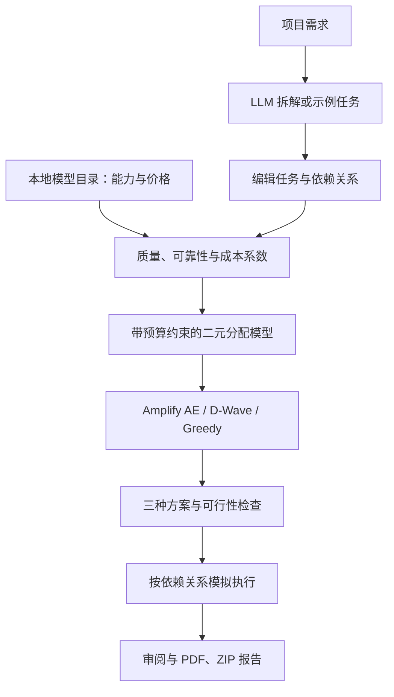

# Quantum Computing for Token Optimization


[English](README.md) · [日本語](README.ja.md) · [简体中文](README.zh-CN.md)

**拆解 AI 任务，比较成本与质量，为每个任务分配合适的模型。**

> 当前应用界面主要为日语。徽章表示技术栈与实现范围，不代表测试通过或已验证量子优势。

## 这个应用解决什么问题

这是一个基于 Streamlit 的 AI 任务分配原型：将项目需求拆解为文档、编程、图像生成等任务，再利用本地模型目录和二元优化模型，在预算范围内权衡预估质量、可靠性与费用，决定每个任务交给哪个模型。

这里的“Token Optimization”指**基于任务费用估算优化模型分配**，费用可以包含输入、输出 token 的价格估算。当前并不压缩提示词，也不直接求解最少生成 token 数。

## 应用如何搭建



- **界面**：Streamlit 展示任务、预算、方案卡片、依赖流程和审阅记录。
- **数据与计算**：Python / NumPy 从本地模型目录计算每个“模型 × 任务”的系数。
- **求解**：Amplify 构建数学模型，连接 Amplify AE 或 D-Wave；Greedy 提供经典启发式方案。
- **交付**：ReportLab 生成 PDF，并将报告及已附加文件打包成 ZIP。

Amplify AE 是**量子启发式**求解服务，D-Wave 路径是**量子退火硬件的接入实现**，Greedy 是经典贪心算法。代码支持接入，不等于已经验证硬件运行效果或量子优势。具体入口见[代码结构](#code-map)，公式见[数学模型](#mathematics)。

## 安装与启动

准备 **Python 3.11–3.13、uv 和 Git**。当前仓库为私有，克隆需要相应账号权限。

```bash
git clone https://github.com/Tsubasaas/Quantum-Computing-for-Token-Optimization.git
cd Quantum-Computing-for-Token-Optimization
uv sync
```

按需将 `.env.example` 复制为 `.env`：

```powershell
# Windows PowerShell
Copy-Item .env.example .env
```

```bash
# macOS / Linux
cp .env.example .env
```

启动：

```bash
uv run streamlit run app/app.py
```

打开终端显示的地址，通常是 `http://localhost:8501`。第一次体验可以不配置 API 密钥，使用示例任务，并将默认的 Amplify AE 改为 **Greedy**。

| `.env` 配置 | 用途 |
|---|---|
| `GROQ_API_KEY` / `OPENAI_API_KEY` | 可选，用于 LLM 需求拆解 |
| `GROQ_BASE_URL`, `GROQ_MODEL` / `OPENAI_BASE_URL`, `OPENAI_MODEL` | 可选，自定义服务地址与模型 |
| `FIXSTARS_AMPLIFY_TOKEN` | 选择 Amplify AE 时必需 |
| `DWAVE_API_TOKEN` | 选择 D-Wave 时必需 |
| `DWAVE_SOLVER` | 可选，指定 D-Wave 求解器 |

密钥保存在已被 Git 忽略的 `.env` 中。LLM 不可用或拆解失败时，应用可能返回**示例任务**，它们不代表对当前需求的真实拆解。远程求解器不可用时会显示错误，不会悄悄切换到其他算法。

## 如何使用、能看到什么效果

1. **输入需求**：例如“搭建活动报名应用，需要首页、后端 API、测试、使用文档和一张宣传图”，选择相关任务类别。
2. **检查任务**：调整难度、重要程度、依赖关系、图片数量及候选模型，设置美元预算和求解器。
3. **比较方案**：查看三种方案的预估总费用、0–5 分质量指标、任务负责人、分类费用及执行阶段。
4. **模拟执行**：选择满足条件的方案，查看按依赖关系分阶段推进的过程，逐项审阅。
5. **下载报告**：完成全部任务审阅后导出 PDF 或 ZIP。ZIP 包含报告和已附加文件；模拟过程不会自动生成计划中的代码、图片或文档。旧版详细页面另有方法比较及 JSON / CSV 导出。

| 方案 | 占最大预算的上限 | α：质量 | β：可靠性 | γ：成本 |
|---|---:|---:|---:|---:|
| 成本优先 | 30% | 1.0 | 0.3 | 3.0 |
| 均衡 | 60% | 1.0 | 0.4 | 1.0 |
| 质量优先 | 100% | 1.0 | 0.5 | 0.0 |

应用的实际价值是把**任务交给谁、预计花多少钱、按什么顺序推进**展示清楚。高质量模型可以分配给重要任务，其他任务则根据预算选择，但是否降低费用取决于数据、权重与可行性，不能预先保证。三种方案也可能得到相同分配。

质量评分由目录中的能力值和难度修正计算，不是对用户项目的实测正确率。结果中的单模型基线使用候选列表的第一个模型，该基线可能不满足所有任务的能力或预算约束，因此比较时需检查适用性。

## 当前实现边界

已实现需求拆解、系数计算、求解器接入、方案比较、可行性检查、模拟执行、审阅与报告打包。尚未接入分配模型后的实际内容生成。LLM 拆解及远程求解仍可能产生服务费用；展示的生成任务费用不是完整账单，也未包含规划、重试、缓存、搜索或税费等全部因素。

当前不宣称已测得固定节省比例、量子加速或全局最优。截止时间约束、依赖调度优化及负载均衡项 μ 未纳入量子求解模型；依赖关系用于展示执行流程，“最大完成时间”输入被用于控制求解搜索时间。模型能力、价格和可用性是仓库内的数据快照，可靠性还包含启发式补充值，使用前应核对数据来源。

<a id="mathematics"></a>
## 数学模型

以下公式对应当前实现。clip 将数值限制在 [0, 1] 范围，带下标 k 的 round 表示保留 k 位小数。

### 1. 变量

| 符号 | 含义 |
|---|---|
| $i=1,\ldots,N$ | 候选模型 |
| $j=1,\ldots,M$ | 任务 |
| $x_{ij}\in\{0,1\}$ | 模型 i 负责任务 j 时取1 |
| $q_{ij},r_{ij}$ | 质量与可靠性 |
| $c_{ij},\hat c_{ij}$ | 美元成本与归一化成本 |
| $w_j=p_j/5$ | 重要性权重（优先级 p 为1–5） |
| $d_j,n_j$ | 难度（1–5）与数量 |
| $B$ | 美元预算 |
| $\alpha,\beta,\gamma$ | 质量、可靠性与成本权重 |

### 2. 质量与可靠性

设任务角色为 $\rho_j$，能力分数为 $s_{ik}$，角色对应的混合权重为 $b_{\rho_j k}$，角色修正系数为 $f_{\rho_j}$：

$$
Q_{i,\rho_j}=\mathrm{clip}_{[0,1]}\left(f_{\rho_j}\sum_k b_{\rho_j k}s_{ik}\right)
$$

$$
q_{ij}=Q_{i,\rho_j}\max\left(0,1-0.12(d_j-1)\right),\qquad w_j=\frac{p_j}{5}
$$

主要能力缺失时禁止分配，次要能力缺失按0参与合成。可靠性优先使用目录中的 SWE-rebench Pass@5，否则使用 $r_{ij}=\mathrm{clip}_{[0,1]}(Q_{i,\rho_j}+0.10)$。这一补充值是启发式估计，不是实测成功概率。

### 3. 成本估算

依次选择第一个可用的成本来源：基准任务费用 → 图像模型的图像单价 → 词元单价 → 默认0.20美元。难度修正倍率为：

$$
m_j=1+0.12(d_j-3)
$$

使用词元价格时，$P_i^{\mathrm{in}}$ 与 $P_i^{\mathrm{out}}$ 分别表示每百万输入、输出词元的美元价格。单个任务的预估单价为：

$$
u_{ij}=\mathrm{round}_4\left[\max\left(0.01,m_j\frac{60000P_i^{\mathrm{in}}+8000P_i^{\mathrm{out}}}{10^6}\right)\right]
$$

基准费用分支的单价下限为0.01美元，图像分支为0.001美元，默认分支使用 $0.20m_j$ 美元。`cost_for` 将其保留四位小数，系数构建阶段再乘以数量，并设置最终0.01美元下限：

$$
c_{ij}=\max\left(0.01,u_{ij}\max(1,n_j)\right),\qquad
\hat c_{ij}=\mathrm{clip}_{[0,1]}\left(\frac{c_{ij}}{c_{\max}}\right)
$$

$c_{\max}$ 是所有允许分配组合中的最大成本；没有允许的组合时取1。输入60,000、输出8,000词元是固定估算假设，不代表实际消耗。

### 4. 目标函数与约束

最大化按重要性加权的质量与可靠性收益，并扣除归一化成本惩罚：

$$
F(x)=\sum_{i=1}^{N}\sum_{j=1}^{M}w_j(\alpha q_{ij}+\beta r_{ij})x_{ij}
-\gamma\sum_{i=1}^{N}\sum_{j=1}^{M}\hat c_{ij}x_{ij}
$$

C1：每个任务恰好分配一个模型。

$$
\mathrm{C1}:\quad\sum_{i=1}^{N}x_{ij}=1\quad\forall j
$$

C2：排除禁止集合 $\mathcal F$ 中的组合，包括能力不足，或“机密任务与被标记为外部的模型”的组合。这是分配规则，不代表已实现数据脱敏或安全隔离。

$$
\mathrm{C2}:\quad x_{ij}=0\quad\forall(i,j)\in\mathcal F
$$

C3：提供预算时，强制约束总费用上限。

$$
\mathrm{C3}:\quad\sum_{i=1}^{N}\sum_{j=1}^{M}c_{ij}x_{ij}\le B
$$

### 5. QUBO 编码

求解器最小化 $E_{\mathrm{obj}}=-F$。每个任务仅选择一个模型的独热约束可写成二次惩罚：

$$
P_{\mathrm{one\text{-}hot}}(x)=\sum_{j=1}^{M}\left(\sum_{i=1}^{N}x_{ij}-1\right)^2
$$

概念上，无约束能量函数可以表示为：

$$
E(x,z)=-F(x)+\lambda_1P_{\mathrm{one\text{-}hot}}(x)+P_{\mathrm{budget}}(x,z)
$$

$z$ 表示辅助编码变量，$P_{\mathrm{budget}}$ 表示预算惩罚项。**应用没有手动选择这一展开形式或 λ 的数值。** 代码将禁用变量固定为0，再把 `Model(objective, constraints)`、`one_hot` 和 `less_equal` 交给 Amplify，由其针对后端进行转换。上式用于解释原理，并不是另外实现的固定惩罚矩阵。

### 6. 展示指标

设 $a(j)$ 为任务 j 的负责模型，$J_a$ 为已分配任务集合。总费用、任务级0–5分质量与平均质量为：

$$
C_{\mathrm{total}}=\sum_{i,j}c_{ij}x_{ij},\qquad
A_j=\mathrm{round}_2(5q_{a(j),j}),\qquad
\overline A=\mathrm{round}_2\left(\frac{1}{|J_a|}\sum_{j\in J_a}A_j\right)
$$

平均质量不按重要性加权，没有已分配任务时返回0。应同时检查 `feasible`（是否可行）、`within_budget`（是否在预算内）与 `violations`（违规数）。Greedy 可能返回违反约束的分配，因此有结果不代表满足全部约束。

<a id="code-map"></a>
## 代码结构

| 路径 | 职责 |
|---|---|
| [`app/app.py`](app/app.py) | 启动入口 |
| [`app/app_pages/workspace.py`](app/app_pages/workspace.py) | 主流程 |
| [`app/delivery.py`](app/delivery.py), [`app/report_pdf.py`](app/report_pdf.py) | 报告打包 |
| [`src/taqumi2026s_teame/llm/`](src/taqumi2026s_teame/llm/) | LLM 接入 |
| [`data/__init__.py`](src/taqumi2026s_teame/data/__init__.py) | 能力合成与费用估算 |
| [`data/models.json`](src/taqumi2026s_teame/data/models.json) | 模型数据快照 |
| [`qubo/coefficients.py`](src/taqumi2026s_teame/qubo/coefficients.py) | 系数矩阵 |
| [`solvers/`](src/taqumi2026s_teame/solvers/) | 求解器 |
| [`plans.py`](src/taqumi2026s_teame/plans.py), [`config.py`](src/taqumi2026s_teame/config.py) | 三方案及权重 |
| [`evaluation/metrics.py`](src/taqumi2026s_teame/evaluation/metrics.py) | 评分与约束检查 |
| [`workflow.py`](src/taqumi2026s_teame/workflow.py) | 依赖分层 |
| [`tests/`](tests/) | 现有测试 |

## 开发

```bash
uv run pytest
uv run ruff check .
uv run ruff format --check .
uv run mypy src
```

以上为检查命令，不代表当前全部通过。真实 API 测试需要单独配置凭证并明确启用。当前分配流程未使用继承的 `qiskit*` 和 `docplex` 依赖。

## 延伸阅读与开发记录

- [应用详解](docs/APP_GUIDE.md)
- [数据计算方法](src/taqumi2026s_teame/data/README.md)
- [实现审查](IMPLEMENTATION_AUDIT.md)
- [测试指南](tests/README.md)

项目在模块声明与审查文档中记录了生成式 AI（包括 Claude）的辅助开发情况。目录保存了数据来源与时间。本 README 不构成对外部基准或最新价格的独立验证。链接中的详细资料目前仍主要为日语。
