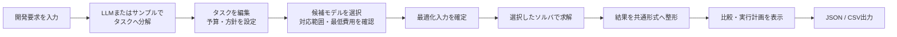
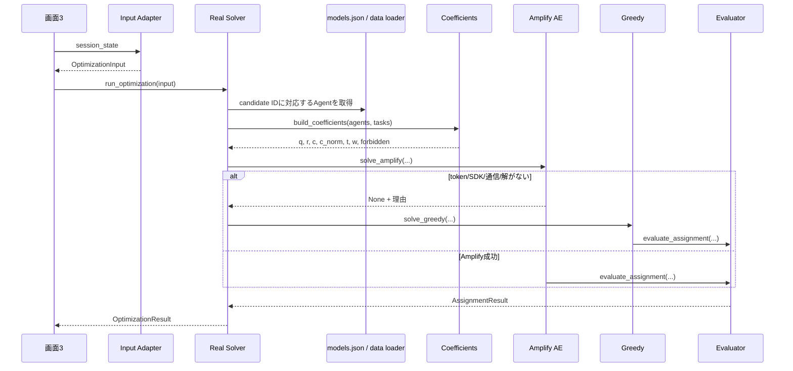

# Q-Orchestrator 全体設計・処理フローガイド

この文書は、Q-Orchestrator を初めて読む人が「何をするアプリか」「画面操作がどの処理につながるか」「各ファイルが何を担当するか」「現在どこまで実装されているか」を一通り理解するための案内です。

> 対象: 現在のリポジトリ実装。画面上の説明より、実際のコードの挙動を優先して記載しています。

## 1. このアプリが解決すること

Q-Orchestrator は、開発要求を小さなタスクに分け、それぞれをどの AI モデル／コーディングエージェントへ任せるか決める Streamlit アプリです。

割当では次の条件を考慮します。

- タスクの種類に対するモデルの品質
- モデルの信頼性
- タスク実行コストと全体予算
- モデルがそのタスク種別に対応できるか
- 機密タスクを社外 API に渡してよいか
- ユーザーが選んだ「品質重視／コスト重視」の度合い

割当問題を二値変数 `x[i,j]`（モデル `i` をタスク `j` に割り当てるなら1）で表し、選択したソルバで解きます。ソルバは Fixstars Amplify AE、D-Wave Advantage、Greedy（貪欲法）から選択できます。

## 2. 利用者から見た全体フロー



### 既定画面: ワークスペース（縦1枚）

`app/app_pages/workspace.py` が既定の画面です。1 枚の縦スクロールで、操作が進むごとに
次のセクションが現れます。ページ切り替えのタブではなく進行表示（01〜04）です。

| 段 | 利用者が行うこと | 主な出力 |
|---|---|---|
| 01 要望 | 要望文の入力、カテゴリ（doc / code / image）の複数選択 | `ws_tasks` |
| 02 タスク | タスク名・難易度・画像枚数の調整、最大予算の決定 | `ws_budget` |
| 03 プラン | 3案の比較・選択、実行フローと配分内訳の確認 | `ws_plans`、`ws_selected_plan` |
| 04 実行 | 模擬実行（依存段ごとの進行表示と、生成予定の成果物一覧） | `ws_run` |

ワークスペースの状態キーはすべて `ws_` 接頭辞で、従来4画面の `session_state` とは独立して
います（片方の編集がもう片方を黙って書き換えないため）。

3 プランは `plans.build_plans()` が作ります。差をつけているのは **予算上限の刻み**
（最大予算の 30% / 60% / 100%）と `config.MODE_WEIGHTS` の α・β・γ だけで、求解自体は既存の
`run_optimization()` をそのまま 3 回呼びます。QUBO の目的関数・制約は変えていません。上限が
違っても配分が同じになった場合は `plans.identical_plan_kinds()` が検出し、画面でも「構成が
同じ」と明示します（架空の差を作らない）。

### 従来の4画面（詳細モード）

ワークスペース最下部のリンクから開けます。候補モデルの絞り込み、手法比較グラフ、
JSON / CSV エクスポートはこちらにあります。

画面は次の4段階です。

| 画面 | 利用者が行うこと | 主な出力 |
|---|---|---|
| 1. タスク設定 | 要求入力、タスク生成・編集、予算と大方針の決定 | `tasks`、`budget_limit`、`optimization_mode` |
| 2. モデル設定 | 候補モデル選択、重み・時間上限・マスキング設定 | `candidate_models`、能力表、重み、最適化入力 |
| 3. 最適化実行 | 入力内容を確認し、ソルバーを起動 | `optimization_result` |
| 4. アウトプット | 結果、比較、違反、実行計画を確認・編集・保存 | JSON、CSV |

画面間の値はデータベースではなく Streamlit の `st.session_state` に保持されます。ブラウザセッションを失うと、入力状態も基本的に失われます。

## 3. システム構成

```text
.streamlit/config.toml            デザイン基準（色・角丸・フォント）

app/                              Streamlit UI
├── app.py                        入口。st.navigation でページ登録（サイドバーは出さない）
├── _boot.py                      src/ を import path に加える
├── workspace_theme.py            濃紺ヘッダー・ステップ・カテゴリ3色・STEP段組みのCSS/HTML
├── ui_helpers.py                 UI変換・検証・グラフ・モデル表
├── output_helpers.py             結果比較・違反・実行計画の整形
├── app_pages/
│   └── workspace.py              既定画面。01要望→02タスク→03プラン→04実行の縦1枚
└── pages/                        従来の4画面（詳細モード）
    ├── 1_タスク設定.py
    ├── 2_エージェント設定.py
    ├── 3_最適化実行.py
    └── 4_アウトプット.py

src/taqumi2026s_teame/            アプリ本体のドメイン処理
├── models.py                     Task / Agent / Weights / Result の型
├── config.py                     モード別の重みとUI既定値
├── planner.py                    要望＋カテゴリ → タスク一覧（LLM 不可ならテンプレート）
├── plans.py                      コスト重視/バランス/精度重視の3プランを求解
├── workflow.py                   依存関係 → STEP 段組み、循環・欠落の検出
├── optimization_contract.py      画面2→3→4の辞書形式の契約
├── optimization_input_adapter.py session_stateを契約形式へ変換
├── data/                          モデルDB、サンプル、能力合成
├── llm/decompose.py              開発要求をタスクへ分解
├── qubo/coefficients.py          モデル×タスク係数行列を生成
├── solvers/                       Amplify / Greedy / Random / Mock
└── evaluation/metrics.py         全ソルバー共通の結果評価

scripts/build_models.py           元データから models.json を構築する補助
tests/                            単体・契約・UI・受け入れテスト
```

依存方向は原則として `UI → 入出力契約／ドメイン処理 → データ・QUBO・ソルバー → 評価` です。UIから直接 Amplify SDK を操作せず、画面3は `run_optimization()` だけを呼びます。

## 4. 画面ごとの処理

### 4.1 トップページ

`app/app.py` はアプリの説明、数式、次画面へのリンクを表示します。また次の環境状態を表示します。

- `FIXSTARS_AMPLIFY_TOKEN` の有無
- `OPENAI_API_KEY` の有無
- Amplify SDK を import できるか

ここでは最適化処理は行いません。

### 4.2 画面1: タスク設定

入口は `app/pages/1_タスク設定.py` です。

1. 初回表示時、`sample_tasks.json` の予約管理アプリ例を読み込みます。
2. 利用者が要求文と任意の参照ファイルを指定します。
3. `LLMでタスク分解する` が有効なら `llm/decompose.py` が OpenAI API を呼びます。
4. LLMを使わない、APIキーがない、通信・JSON解析に失敗した場合はサンプルへ戻ります。この場合は成功ではなく警告表示です。
5. 生成結果を既存一覧と置換または追記します。追記ではIDと依存先IDを付け替えます。
6. `st.data_editor` でタスク名、種類、重要度、難易度、作業量、機密性、依存関係などを編集します。
7. 予算上限と最適化方針を設定します。
8. 入力を検証し、ドメインの `Task` と次工程向けデータを `session_state` に保存します。

参照ファイルの本文は最大8,000文字までLLMの追加コンテキストになります。対応形式や10MB制限の検証は `ui_helpers.py` が担当します。PDFは現状、本文抽出ではなくファイル名の記録に留まる場合があります。

タスクの主要項目は次の通りです。

| 項目 | 意味 | 最適化での利用 |
|---|---|---|
| ID | `T001` 形式の識別子 | 結果・依存関係のキー |
| タスク名 | 人向けの説明 | 表示のみ |
| 種類 `role` | 必要な能力の分類 | 品質算出と担当可否 |
| 重要度 | 1〜5 | `w[j] = importance / 5` |
| 難易度 | 1〜5 | 品質低下・コスト増の補正 |
| 作業量 | 見積り時間 | 処理時間係数の算出 |
| 機密性 | 機密タスクか | 社外モデルへの割当禁止 |
| 依存タスク | 先に終えるべきタスク | 現状は編成図・出力表示のみ |

### 4.3 画面2: モデル設定

`app/pages/2_エージェント設定.py` は `models.json` を `Agent` 一覧へ変換し、候補を選ばせます。

- 提供元、種別、対応カテゴリ、名前、社内モデルで絞り込み
- 各モデルの公開ベンチマーク値、価格、対応範囲を表示
- 2モデル以上が選ばれているか検証
- 全タスクを担当できる候補が揃っているか検証
- 機密タスクに社内モデルが存在するか確認
- 最安構成の概算が予算内か確認
- 品質とコストのバランスから `gamma` を設定
- 任意の最大完了時間とマスキングフラグを保存

この画面で作る主要な共有値は以下です。

| session_stateキー | 内容 |
|---|---|
| `candidate_models` | 選択したモデルID一覧 |
| `model_capability_matrix` | モデルごとの能力・価格・出典情報 |
| `optimization_weights` | `alpha`, `beta`, `gamma`, `mu` |
| `budget_limit` | 画面1で設定したUSD予算 |
| `max_completion_time` | 任意の時間上限 |
| `masking_enabled` | マスキング設定値 |
| `mode` | コスト優先／バランス／精度優先 |

### 4.4 画面3: 最適化実行

`app/pages/3_最適化実行.py` は実行ボタンを押したときだけ本処理を呼びます。

1. `build_optimization_input(session_state)` が入力契約を組み立てます。
2. 必須の上流データが不足している場合だけ Mock 入力へフォールバックします。画面には「上流実データ」または「Mock」と表示されます。
3. 前回実行時と入力が変わった場合、古い結果を破棄します。
4. `run_optimization()` を呼び、結果を `optimization_result` に保存します。
5. 成功、タイムアウト、エラーを分けて表示します。

### 4.5 画面4: アウトプット

`app/pages/4_アウトプット.py` は、保存された入力と結果が一致していることを確認してから表示します。

- 総コスト、平均精度、計算時間
- 候補リスト先頭の単一モデルに全タスクを固定した場合との比較
- タスクごとの精度理由
- 未割当、予算超過などの制約違反
- タスク別のモデル、マスキング、レビュー、コスト、精度を含む実行計画
- 自動生成された response と利用者が編集した response
- 入力・結果・違反・response をまとめた JSON
- 実行計画の CSV

編集済み response と生成直後の response は別々に保持するため、編集しても元文は失われません。

## 5. 最適化処理の内部フロー

実行の唯一の公開入口は `solvers/optimization_real_solver.py` の `run_optimization()` です。



### 5.1 入力変換と検証

`optimization_input_adapter.py` は、画面間の個別状態を `OptimizationInput` へ統一します。タスク、候補モデル、能力表、重み、予算、時間、マスキング、モードが型も含めて揃っている場合のみ実データと判定します。

`run_optimization()` は例外を外へ投げず、`status="error"` の `OptimizationResult` に変換します。このため不正入力や候補ID不一致でStreamlit全体が落ちません。

### 5.2 モデル能力とコストの生成

`data/models.json` がモデル情報の正本です。`data/__init__.py` は次の変換を行います。

- タスクの役割ごとに、必要な能力カテゴリを重み付き合成して品質 `Q` を作る
- 主能力が `null` のモデルは、その役割を担当不可にする
- SWE-rebenchのPass@5があれば信頼性に利用し、なければ品質から補完する
- コストは「ベンチマーク実測コスト → API単価による推計 → 既定値」の順で求める
- 社外APIかつローカル実行不可のモデルを `external=True` とする

役割と能力カテゴリの対応・ブレンドは `data/task_types.py` に集約されています。そのため、新しい役割や能力軸を増やす場合は、まずこのファイルと `models.json` を更新します。

### 5.3 係数行列

`build_coefficients()` は、モデル数 `N` × タスク数 `M` の行列を作ります。

| 係数 | 意味 |
|---|---|
| `q[i,j]` | 難易度補正後の品質 |
| `r[i,j]` | 信頼性 |
| `c[i,j]` | 実コスト（USD） |
| `c_norm[i,j]` | 目的関数用の0〜1正規化コスト |
| `t[i,j]` | モデル基準時間、難易度、作業量から求めた処理時間 |
| `w[j]` | タスク重要度 |
| `forbidden[i,j]` | 能力不足、または機密×社外の割当禁止 |

難易度が1上がるごとに品質係数は0.12ずつ低下します。コストは難易度3を基準に増減します。正規化コストの最大値計算から禁止セルを除くことで、割当不能な高額セルがスコア尺度を歪めないようにしています。

### 5.4 目的関数と制約

現在、実際に最適化している最大化目的は次です。

```text
F = Σ(i,j) w[j] × (alpha × q[i,j] + beta × r[i,j]) × x[i,j]
    - gamma × Σ(i,j) c_norm[i,j] × x[i,j]
```

Amplifyは最小化形式なので、実装では品質・信頼性項の符号を反転してモデル化します。

実装済みの制約:

- C1: 各タスクにはちょうど1モデルを割り当てる（one-hot）
- C2: 能力不足、および機密タスク×社外モデルの変数を0に固定
- C3: 合計実コストが予算以下

重みの意味:

- `alpha`: 品質。モードで決まり、通常1.0
- `beta`: 信頼性。モードで決まる
- `gamma`: コスト。利用者のスライダーで0.0〜4.0
- `mu`: 負荷分散用に予約されているが、現行目的関数では未使用

### 5.5 ソルバーの選択

`solve_amplify()` は、トークン、SDK、通信、認証、実行可能解の有無を確認します。成功時は各タスク列で値1のモデルを読み取り、割当ベクトルへ変換します。

失敗時は `run_optimization()` が必ず `solve_greedy()` を試します。Greedyは重要度・難易度の高いタスクから順に、予算内で限界スコアが最大のモデルを選びます。途中で予算上選べなくなった場合は、機密制約を守れる最安モデルを選ぶため、結果自体は返っても `feasible=False` になることがあります。

`solve_random()` は同じ係数・評価式を使う再現可能な比較用基準線です。現在の画面3の本実行経路からは直接呼ばれません。

### 5.6 評価と出力整形

`evaluation/metrics.py` は全ソルバー共通で次を集計します。

- タスクID → モデルIDの割当
- モデルごとの担当タスク
- 重み付き品質、信頼性、コスト、目的関数値
- モデル別時間の最大値（makespan）
- 担当数の標準偏差
- 禁止割当、未割当、容量、予算の違反
- `feasible`、`within_budget`、診断用の `within_deadline`

その後、Real SolverがUI契約の `OptimizationResult` に変換し、精度を0〜1から0〜5へ換算します。また比較用に、候補リストの先頭モデルへ全タスクを固定したベースラインを作ります。

## 6. 入出力契約

画面とソルバーの境界は `optimization_contract.py` の `TypedDict` で定義されています。

### OptimizationInput

```text
tasks[]                  タスクID、名前、種類、重要度、難易度、作業量、機密、依存
candidate_models[]       models.json の model_id
model_capability_matrix  UI表示・確認用のモデル情報
optimization_weights     alpha / beta / gamma / mu
budget_limit             USD
max_completion_time      秒またはNone
masking_enabled          真偽値
optimization_mode        方針名
```

### OptimizationResult

```text
status                    success / timeout / error
optimal_assignment        task_id -> model_id
solve_time_seconds
total_cost
average_accuracy_score    0〜5
message
task_results[]            タスク別モデル・費用・精度・マスキング等
baseline                  単一モデル固定時の比較値
```

この契約により、Mock SolverとReal Solver、または将来の別ソルバーをUIを大きく変えずに交換できます。

## 7. 実装済み・未実装の境界

混同しやすい点を、現在のコードに基づいて整理します。

| 項目 | 現在の状態 |
|---|---|
| 予算 | Amplify制約・Greedy選択・結果判定に反映済み |
| タスク種別ごとの能力 | 品質と割当可否に反映済み |
| 機密タスク | 社外モデルへの割当禁止として反映済み |
| 品質／信頼性／コスト重み | 目的関数へ反映済み |
| 依存関係 | 保存・表示・編成図のみ。順序制約には未反映 |
| 最大完了時間 | Amplifyの探索時間上限（最大30秒）へ流用。締切制約C4ではない |
| `within_deadline` | 結果の診断値のみ。`feasible` 判定には不使用 |
| 負荷分散 `mu` | 型とUIに存在するが目的関数には未反映 |
| hard capacity | 評価器に処理はあるが、現行UIでは無効固定 |
| マスキング | フラグを入力・タスク結果へ渡すのみ。実際のマスキング処理は未実装 |
| レビュー工程 | 出力契約に項目はあるが、Real Solverでは無効／モデルなし |
| Gurobi | 環境変数だけ予約。未実装 |
| Mock Solver | 上流入力不足時と契約テスト用。本実行の主経路ではない |
| ワークスペースの3プラン | 実装済み。既存 `run_optimization()` を予算上限違いで3回呼ぶ |
| タスクの `quantity`（画像枚数） | コスト行列 `c` を線形倍する形で反映済み。制約・目的関数の形は不変 |
| 依存関係の STEP 段組み | 表示と模擬実行の進行順として実装済み。QUBO の順序制約にはなお未反映 |
| 04 実行（成果物生成） | **未実装**。模擬実行のみ。生成 API も成果物ストアも接続していない |
| 文書作成タスクの品質 | IDP Leaderboard の「文書理解・抽出」を**代理指標**として使用。文章生成能力そのものの実測値ではない |

トップページの数式には締切と負荷分散も将来形として表示されていますが、現行ソルバーが使う式は「品質・信頼性・コスト」とC1〜C3までです。

## 8. 外部サービスと環境変数

| 変数 | 使用箇所 | 未設定時 |
|---|---|---|
| `FIXSTARS_AMPLIFY_TOKEN` | Amplify AE | Amplify AEの実行結果でエラー表示 |
| `OPENAI_API_KEY` | タスク分解 | サンプルタスクを使用 |
| `OPENAI_BASE_URL` | OpenAI互換APIの接続先 | SDK既定値 |
| `OPENAI_MODEL` | タスク分解モデル | `gpt-4o-mini` |
| `GUROBI_SERVER` / `GUROBI_PASSWORD` | 将来用 | 影響なし |

秘密情報は `.env` に置き、コミットしません。`.env.example` が設定例です。

## 9. 起動・検証

```bash
uv sync
uv run streamlit run app/app.py
```

LLM分解も使う場合:

```bash
uv sync --extra llm
```

主な品質確認:

```bash
uv run pytest
uv run ruff check .
uv run ruff format --check .
uv run mypy src
```

テストは、係数の形と値域、品質・コストのトレードオフ、予算境界、機密制約、Greedy/Randomの再現性、LLMフォールバック、入出力アダプター、Real/Mock Solver、画面1の編集、画面4の受け入れ条件をカバーしています。Amplifyの実通信はトークン不要のガード経路を中心に検証しています。

## 10. 変更するときの道案内

| 変更したいこと | 主に見る場所 |
|---|---|
| タスク項目・結果項目を増やす | `models.py`、`optimization_contract.py`、Adapter、各画面 |
| タスクの種類を増やす | `data/task_types.py`、`models.json`、画面1 |
| モデル・価格・ベンチ値を更新する | `data/models.json`、`scripts/build_models.py`、`data/README.md` |
| 品質やコストの計算を変える | `data/__init__.py`、`qubo/coefficients.py` |
| 目的関数・制約を変える | `amplify_solver.py`、`classical.py`、`evaluation/metrics.py` |
| 新しいソルバーを追加する | `solvers/`、`optimization_real_solver.py` |
| 画面間の受け渡しを変える | `optimization_contract.py`、`optimization_input_adapter.py` |
| 出力表・違反表示・エクスポートを変える | `app/output_helpers.py`、画面4 |
| UI共通処理を変える | `app/ui_helpers.py` |
| ワークスペースの画面を変える | `app/app_pages/workspace.py` |
| 配色・余白・カードの見た目を変える | `.streamlit/config.toml`、`app/workspace_theme.py` |
| カテゴリ（doc/code/image）の写像を変える | `src/taqumi2026s_teame/data/task_types.py` |
| タスクのテンプレート・キーワードを変える | `src/taqumi2026s_teame/planner.py` |
| プランの本数・予算の刻みを変える | `src/taqumi2026s_teame/plans.py` の `PLAN_SPECS` |

目的関数を変更するときは、Amplify、Greedy、Random、評価器の式を揃える必要があります。契約項目を変えるときは、画面2の生成、Adapter、Real/Mock Solver、画面4、契約テストを一緒に更新してください。

## 11. 現状の設計上の注意点

- 状態管理が `session_state` に集中しており、同じ概念に新旧互換キーが併存しています。大きな改修時は `OptimizationInput` を正本に寄せると追跡しやすくなります。
- 画面2が一度簡易 `optimization_input` を保存しますが、画面3では個別の状態からAdapterが契約形式を再構築します。
- Real Solverのベースラインは「最良の単一モデル」ではなく「候補リスト先頭のモデル」です。
- Greedyは予算・容量で候補が詰まった場合も割当を返し、制約違反を結果へ記録します。成功ステータスでもメッセージと違反表示を確認してください。
- モデル能力値と価格には取得時点があります。更新時は値だけでなく出典と日付も保守してください。
- より細かな既知課題と生成AI利用記録は `IMPLEMENTATION_AUDIT.md` にあります。

## 12. 最短でコードを読む順番

1. `app/pages/1_タスク設定.py` で入力項目を把握する
2. `app/pages/2_エージェント設定.py` で候補と重みの作り方を見る
3. `optimization_contract.py` で境界データを把握する
4. `solvers/optimization_real_solver.py` で主処理を追う
5. `data/__init__.py` と `qubo/coefficients.py` で係数の由来を確認する
6. `solvers/amplify_solver.py` と `solvers/classical.py` で求解方法を比較する
7. `evaluation/metrics.py` と画面4で結果の意味を確認する

この順なら、UIの入力がどの係数になり、どの制約を通り、どの出力へ現れるかを最短距離で追えます。
