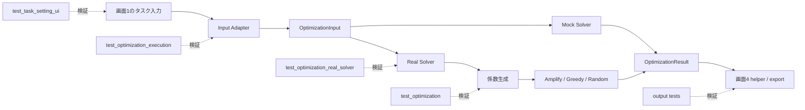

# テスト仕様・期待結果一覧

このディレクトリには、Q-Orchestrator のタスク編集、係数生成、割当、入出力契約、Mock／Real Solver、アウトプット整形を検証するテストがあります。

## 全体マップ

| テストファイル | テスト数 | 対象 | 主に保証すること |
|---|---:|---|---|
| `test_task_setting_ui.py` | 26 | 画面1の入力・編集ヘルパー | ID、入力検証、DataFrame変換、依存関係を壊さない |
| `test_optimization.py` | 21 | 係数、データ、Greedy／Random／Amplify入口 | 最適化の基本ロジックと制約が正しい |
| `test_optimization_execution.py` | 10 | Input Adapter、Mock Solver | 画面間契約とMockの成功・失敗・タイムアウト |
| `test_optimization_real_solver.py` | 6 | Real Solver | 実データを使った一連の割当と結果形式 |
| `output/test_output_helpers.py` | 6 | 画面4の表示変換 | 表、比較、編成図、違反説明を正しく作る |
| `output/test_output_acceptance.py` | 9 | 画面4の受け入れ条件 | 結果が表示・比較・JSON出力に必要な情報を持つ |
| **合計** | **78** | | |



## テストの読み方

以下の表では、各テストを「何を渡すか → 何が返る／どうなるべきか」で示します。

- `OptimizationInput`: タスク、候補モデル、重み、予算などを持つソルバー入力
- `OptimizationResult`: `status`、割当、費用、精度、タスク別結果などを持つ出力
- `AssignmentResult`: ソルバー内部の割当と評価指標
- `Mock Solver`: 固定的なダミー結果を作る契約確認用実装
- `Real Solver`: モデルDBと係数を使い、AmplifyまたはGreedyで割り当てる本実装

## `test_task_setting_ui.py`

画面1のヘルパー関数を直接テストします。Streamlit画面をブラウザ操作するテストではありません。

### ID・追加・編集・削除

| テスト | 入力／操作 | 期待結果 |
|---|---|---|
| `test_at01_auto_id_generation` | `T001`, `T002` がある辞書で次IDを生成 | `T003`。追加後の次は `T004` |
| `test_at02_edit_task` | `T001` の重要度を4へ変更 | IDは `T001` のまま、重要度だけ4 |
| `test_at03_delete_task` | `T001` を削除 | `T001` がなくなり、残り1件 |
| `test_df_to_tasks_dict_assigns_id_to_new_rows` | IDなしの新規行と完全空行を追加 | 新規行だけ自動採番され、空行は破棄 |
| `test_normalize_task_id_pads_to_three_digits` | `T1`, `T01`, `t12`, 独自ID, `None` | 標準IDは `T001` 等へ正規化。独自IDは維持、`None` は空文字 |
| `test_sample_tasks_use_canonical_ids` | サンプルタスクと依存ID | すべて `T` + 3桁形式 |
| `test_two_digit_ids_are_normalized_with_dependencies` | `T01` に依存する `T02` | IDは `T001`, `T002`、依存先も `T001` へ更新 |
| `test_new_row_id_matches_existing_width` | サンプル一覧へ行を追加 | 既存最大番号+1の3桁ID |
| `test_duplicate_ids_do_not_silently_drop_tasks` | 正規化すると衝突するIDを含む3タスク | 重複を採番し直し、3件すべて残る |

### 入力検証と契約生成

| テスト | 入力／操作 | 期待結果 |
|---|---|---|
| `test_at04_empty_task_name_validation` | 空白だけのタスク名 | 「タスク名が空」のエラー |
| `test_at05_budget_validation` | 予算0または負数 | 「0より大きい値」のエラー |
| `test_at06_importance_validation` | 重要度6 | 「1〜5の範囲」のエラー |
| `test_at07_valid_without_file` | 正常なタスク・予算、参照ファイルなし | エラーなし `[]` |
| `test_at08_unsupported_file_extension` | `virus.exe` | 未対応形式エラー |
| `test_at11_tasks_dict_7_columns` | タスク辞書をDataFrame化 | 必須7カラムがすべて存在 |
| `test_at12_optimization_input_structure` | タスク、予算1500、方針、60秒 | `tasks` と `config` があり、各値が入力どおり |

### 変換・依存関係

| テスト | 入力／操作 | 期待結果 |
|---|---|---|
| `test_compatibility_with_model_tasks` | `Task` 一覧を辞書化して戻す | 件数、必須列、先頭IDを維持 |
| `test_difficulty_and_dependencies_survive_round_trip` | サンプルを `Task → dict → Task` 変換 | 難易度と依存関係が全件一致 |
| `test_data_editor_round_trip_is_lossless` | 辞書を編集用DataFrameへ変換して戻す | 元の辞書と完全一致 |
| `test_merge_generated_tasks_append_remaps_dependencies` | 既存一覧へ生成一覧を追記 | 件数が2倍、全依存先が実在する新ID |
| `test_merge_generated_tasks_replace_discards_existing` | 既存一覧を3件の生成結果で置換 | 既存を捨てて3件だけになる |
| `test_dependencies_column_holds_a_list_for_multiselect` | 編集用DataFrameを生成 | 依存列はすべてリスト。サンプルの依存内容も一致 |
| `test_parse_dependencies_accepts_list_string_and_missing` | リスト、半角／全角カンマ文字列、`None`, `NaN` | 正規化したIDリスト。欠損は空リスト |
| `test_self_reference_is_dropped` | `T002` の依存に `T002` 自身を含める | 自己参照だけ除去し、正常な `T001` は維持 |
| `test_stale_dependencies_reports_unknown_and_self` | 未知ID、自己参照、正常依存を混在 | 未知IDと自己参照だけ問題として返す |
| `test_task_editor_df_hides_invalid_dependencies` | 削除済みIDを依存に含める | 表示用DataFrameから無効依存だけ除外 |

## `test_optimization.py`

モデルDBからサンプルタスク、係数、バランス重みを作る共通fixtureを使い、最適化の部品を検証します。

### 係数・目的関数・制約

| テスト | 入力／操作 | 期待結果 |
|---|---|---|
| `test_coefficient_shapes` | 全モデル×全サンプルタスクで係数生成 | `q`, `c_norm` が `(モデル数, タスク数)`、コスト正、正規化値0〜1、禁止セルあり |
| `test_gamma_trades_quality_for_cost` | Greedyを `gamma=0` と `gamma=3` で実行 | 高gammaの方が安く、品質は高gamma側が上回らない |
| `test_mu_does_not_affect_objective` | `mu=0` と `mu=5` | 現行仕様では割当と目的関数値が同じ |
| `test_deadline_does_not_affect_feasible` | 締切なしと0.001秒 | 割当と `feasible` は同じ |
| `test_within_deadline_diagnostic_still_reflects_option` | 締切0.001秒 | `within_deadline=False` だが、締切だけでは `feasible=False` にならない |
| `test_within_budget_boundary` | 一度求めた総コストを次の予算に設定 | 予算と費用が同額でも `within_budget=True` |
| `test_capability_ok_independent_of_confidentiality` | 能力表と禁止表を比較 | 能力なしは必ず禁止。能力ありでも機密×社外は禁止になり得る |
| `test_cost_norm_ignores_forbidden_cells_for_max` | 正規化コストを手計算 | 許可セルの最大コスト基準と一致 |
| `test_metric_cost_matches_manual` | 割当セルのコストを手計算 | `metric.cost_total` と一致 |
| `test_infeasible_budget_flagged` | Greedyへ予算0.5ドル | 予算を守るか、守れなければ `within_budget=False` |

### データと能力合成

| テスト | 入力／操作 | 期待結果 |
|---|---|---|
| `test_models_json_is_sane` | `models.json` 全件 | 20件以上、能力0〜1、全カテゴリ存在、出典・検証済みメタあり |
| `test_quality_synthesis_and_join` | モデル能力から役割品質とタスク別表を生成 | 品質0〜1、主能力なしは `None`、全タスク行あり、Q非負・C正 |
| `test_model_setup_helpers` | 能力表、カバレッジ、最低費用を生成 | 表に必要項目あり、全モデルなら穴なし、社外のみでは機密に穴、最低費用は正 |

### ソルバーとLLMフォールバック

| テスト | 入力／操作 | 期待結果 |
|---|---|---|
| `test_greedy_assigns_every_task_once` | Greedy、予算20ドル | 全タスクIDが割当辞書に1回ずつ存在、メッセージ空 |
| `test_greedy_respects_confidentiality` | 機密タスクを含む一覧 | 機密タスクの担当は `external=False` |
| `test_greedy_beats_random` | 同じ入力・seedでGreedyとRandom | Greedyの目的関数値がRandom以上 |
| `test_greedy_is_deterministic` | 同条件でGreedyを2回 | 割当が一致 |
| `test_random_seed_reproducible` | 同じseedでRandomを2回 | 割当が一致 |
| `test_amplify_without_token_returns_message` | 空トークンでAmplify実行 | 結果は `None`、メッセージにトークン名 |
| `test_decompose_fallback_without_llm` | `use_llm=False` で要求を分解 | 3件以上のサンプルタスクと「サンプル」メッセージ |
| `test_decompose_request_reports_that_llm_was_not_used` | APIキーなしでLLM未使用／使用要求 | `used_llm=False`。使用要求時はキー未設定理由も返る |

## `test_optimization_execution.py`

画面2相当の状態を共通入力へ変換するAdapterと、画面3・4の開発に使えるMock Solverを検証します。

| テスト | 入力／操作 | 期待結果 |
|---|---|---|
| `test_mock_solver_task_accuracy_average_is_not_zero` | 標準Mock入力 | タスク精度平均が0より大きく、結果の平均値と一致 |
| `test_adapter_uses_complete_upstream_state_without_reinterpreting_weights` | 必須キーが揃ったsession state | `is_upstream=True`、ID・候補・重み・予算・モードをそのまま保持 |
| `test_adapter_falls_back_to_mock_when_upstream_state_is_incomplete` | `tasks=[]` だけ | `is_upstream=False`、標準Mock入力と一致 |
| `test_mock_solver_accepts_none_completion_time` | 最大完了時間 `None` | `status="success"` |
| `test_run_optimization_returns_success_with_mock_input` | 標準Mock入力 | success、全タスク割当、正の費用・精度、入力と同数のタスク結果 |
| `test_mock_solver_keeps_total_cost_within_budget` | 予算1.0 | 総コストが1.0以下、タスク別費用合計と一致 |
| `test_mock_solver_keeps_rounded_cost_within_tight_budget` | 予算0.1 | 丸め後も総額・明細合計が0.1以下 |
| `test_mock_solver_accuracy_average_stays_between_zero_and_five` | 標準Mock入力 | 最適化後とベースラインの平均精度が0〜5 |
| `test_run_optimization_returns_error_when_tasks_empty` | タスクを空にする | `status="error"`、空でないメッセージ |
| `test_run_optimization_returns_timeout_when_time_limit_too_short` | 最大完了時間0 | `status="timeout"` |

## `test_optimization_real_solver.py`

本番と同じ `optimization_real_solver.run_optimization()` を検証します。Greedyを明示選択して、実データを使う古典ヒューリスティックを検証します。Mock Solverのテストではありません。

| テスト | 入力／操作 | 期待結果 |
|---|---|---|
| `test_run_optimization_assigns_every_task_with_full_roster` | 全モデルを候補にして全サンプルタスクを実行 | success、制約注記なし、全タスクを候補内モデルへ割当 |
| `test_run_optimization_reports_infeasible_when_category_uncovered` | 画像生成能力のないモデルだけを候補にする | 契約上はsuccessだが、メッセージに「一部の制約」 |
| `test_run_optimization_treats_zero_budget_as_real_constraint` | 予算0.0 | 0を無制限扱いせず、success結果に制約違反注記 |
| `test_run_optimization_rejects_empty_tasks_or_models` | タスク・候補モデルを空にする | `status="error"`、割当は空辞書 |
| `test_run_optimization_baseline_uses_first_candidate` | 候補モデル一覧を渡す | baselineのモデルは候補先頭、費用非負、精度0〜5 |
| `test_run_optimization_accuracy_score_is_on_0_to_5_scale` | 全モデル候補で実行 | 全タスク精度と平均精度が0〜5 |

## `output/test_output_helpers.py`

画面4が `OptimizationResult` を表やGraphvizへ変換する純粋関数を検証します。

| テスト | 入力／操作 | 期待結果 |
|---|---|---|
| `test_task_plan_rows_maps_contract_fields` | 2タスクの入力・結果を実行計画行へ変換 | 2行になり、レビュー担当とマスキングONを保持 |
| `test_assignment_tree_dot_groups_tasks_by_model` | 2モデル、依存あり、機密あり | 有効なDOT、モデルごとに2クラスタ、依存矢印、鍵マークあり |
| `test_assignment_tree_dot_puts_unassigned_tasks_in_own_cluster` | 割当なしの `T03` | 「未割当」クラスタに `T03` |
| `test_accuracy_helpers_explain_each_task` | 明示理由あり／なしのタスク結果 | 平均4.00の説明、明示理由を保持、不足理由はモデル名を使い補完 |
| `test_comparison_rows_include_baseline` | 最適化結果とbaseline | 「最適化前」「最適化後」の順で2行、baseline精度も一致 |
| `test_constraint_helper_reports_missing_assignment` | `T03` だけ割当なし | 「全タスク割当」違反として `T03` を説明 |

## `output/test_output_acceptance.py`

画面4が必要とする結果契約を、Mock Solverの結果を使って受け入れレベルで検証します。

| テスト | 入力／操作 | 期待結果 |
|---|---|---|
| `test_all_tasks_have_selected_models` | 標準Mock入力を実行 | success、全入力タスクに空でないモデルID |
| `test_summary_contains_required_metrics` | 成功結果 | 費用・計算時間は非負、平均精度0〜5 |
| `test_result_contains_single_model_baseline` | 成功結果 | baselineモデルあり、費用非負、精度0〜5 |
| `test_budget_limit_is_comparable_with_actual_cost` | 標準Mock入力と結果 | 総コストが入力予算以下 |
| `test_output_contract_never_exceeds_budget_for_small_limit` | 予算0.01 | successかつ総コスト0.01以下 |
| `test_task_results_include_masking_and_review_details` | タスク別成功結果 | モデル、真偽値のマスキング／レビュー、任意レビュー担当、精度理由あり |
| `test_json_export_preserves_input_and_result` | 入力と結果をJSON往復 | 割当と予算が変わらない |
| `test_generated_response_can_be_edited_without_losing_original` | 生成文と編集文を別変数で保持 | 編集文と異なっても生成直後の文は不変 |
| `test_failed_result_exposes_constraint_message` | timeout結果 | success以外でもユーザー向けメッセージが空でない |

## 実行方法

すべて実行:

```bash
uv run pytest
```

ファイル単位:

```bash
uv run pytest tests/test_optimization.py
uv run pytest tests/test_task_setting_ui.py
uv run pytest tests/test_optimization_execution.py
uv run pytest tests/test_optimization_real_solver.py
uv run pytest tests/output
```

1件だけ実行:

```bash
uv run pytest tests/test_optimization.py::test_gamma_trades_quality_for_cost
```

詳細表示:

```bash
uv run pytest -vv
```

## テスト実行時の注意

- 通常のテストに `FIXSTARS_AMPLIFY_TOKEN` は不要です。
- Real Solverテストは、Greedyを明示選択して実行します。
- OpenAI APIは呼びません。LLM関連はキーなし／未使用時のサンプルフォールバックを検証します。
- `test_task_setting_ui.py` と `output/test_output_helpers.py` は主にUI helperの関数テストで、ブラウザ上の見た目そのものは検証しません。
- 実際のAmplify通信、OpenAI API通信、StreamlitのE2Eブラウザ操作は、この78テストの直接の対象外です。
- テストを追加・削除した場合は、このREADMEの件数と対応表も更新してください。


## `tests/test_workspace_flow.py`（ワークスペース）

UI 実装プロンプト §11「機能」の受け入れ条件を、Streamlit を起動せずに検証する。

| テスト | 確認していること |
|---|---|
| `test_every_role_maps_to_a_plan_category` | ROLES が doc/code/image のどれかへ必ず写る（取りこぼすとタスクが画面から消える） |
| `test_all_seven_category_combinations_produce_valid_tasks` | 3カテゴリの単独・複合 全7通りで、選んだ種類だけが出て依存も壊れない |
| `test_dropping_doc_category_removes_dangling_prerequisites` | 文書カテゴリを外すと、存在しない文書タスクへの依存が残らない |
| `test_request_keywords_add_related_tasks` | CSV・認証などの語で関連タスクが増え、認証は機密扱いになる |
| `test_prune_dependencies_drops_unknown_self_and_cycles` | 未知ID・自己参照・循環を依存から除く |
| `test_levels_group_parallel_tasks_and_respect_order` | 前提が済んだタスクが同じ STEP に並ぶ |
| `test_three_plans_use_budget_slices` | 3案の上限が最大予算の 30% / 60% / 100% |
| `test_feasible_plans_stay_within_their_budget_cap` | 実行可能と表示する案が上限を超えない |
| `test_plan_total_matches_task_breakdown` | カードの合計費用とタスク別内訳・カテゴリ別内訳が一致 |
| `test_image_tasks_only_go_to_image_capable_models` | 画像生成が画像出力対応モデルにだけ割り当たる |
| `test_image_count_change_recomputes_image_cost` | 画像枚数を変えると画像費用が再計算される |
| `test_tiny_budget_marks_every_plan_infeasible` | 全案実行不可を正しく表示し、タスクを省いて成功に見せない |
| `test_identical_plans_are_reported_not_faked` | 配分が同じ案を「同じ」と報告する（架空の差を作らない） |

## `tests/test_workspace_app.py`（ワークスペース画面）

`streamlit.testing.v1.AppTest` でブラウザなしに画面を動かす。§8「状態管理・変更時の挙動」の確認。

| テスト | 確認していること |
|---|---|
| `test_initial_render_shows_only_the_brief_step` | 初期表示は要望入力と種類選択だけ |
| `test_full_flow_reaches_simulated_execution` | 要望 → タスク → 3プラン → 模擬実行 が通り、全タスクが done になる |
| `test_switching_plan_discards_the_previous_run` | プランを切り替えると前の実行結果を持ち越さない |
| `test_editing_tasks_invalidates_plans_and_run` | 入力変更後に古いプランを実行できない |
| `test_changing_budget_invalidates_plans_but_keeps_tasks` | 予算変更はプランだけ無効化し、タスクは残す |
| `test_unchanged_input_keeps_plans_across_reruns` | revision 照合が再実行ループになっていない |
| `test_tiny_budget_shows_every_plan_as_infeasible` | 全案不可のとき実行ボタンを出さない |
| `test_empty_request_reports_an_error_without_building_tasks` | 空入力・カテゴリ未選択のエラー文言 |
| `test_legacy_pages_still_open` | 従来4画面が st.navigation 配下で開ける |
